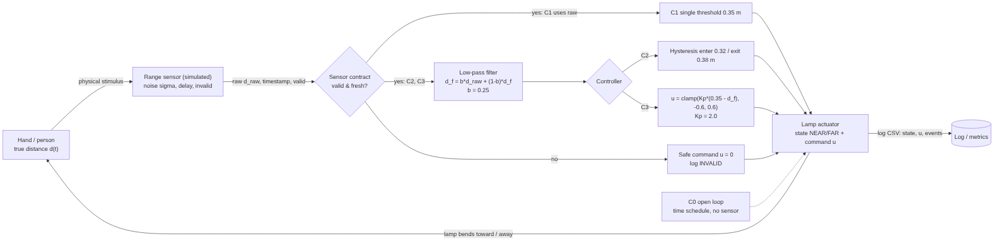
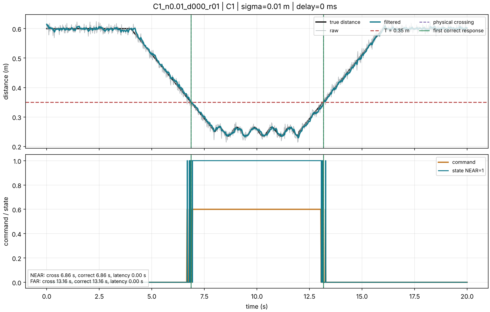
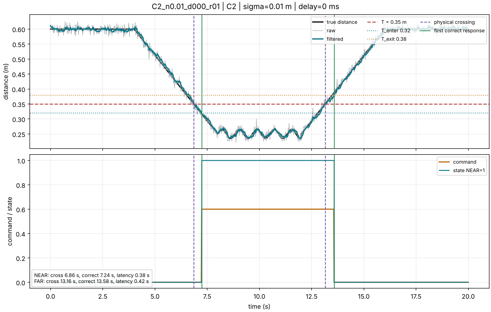
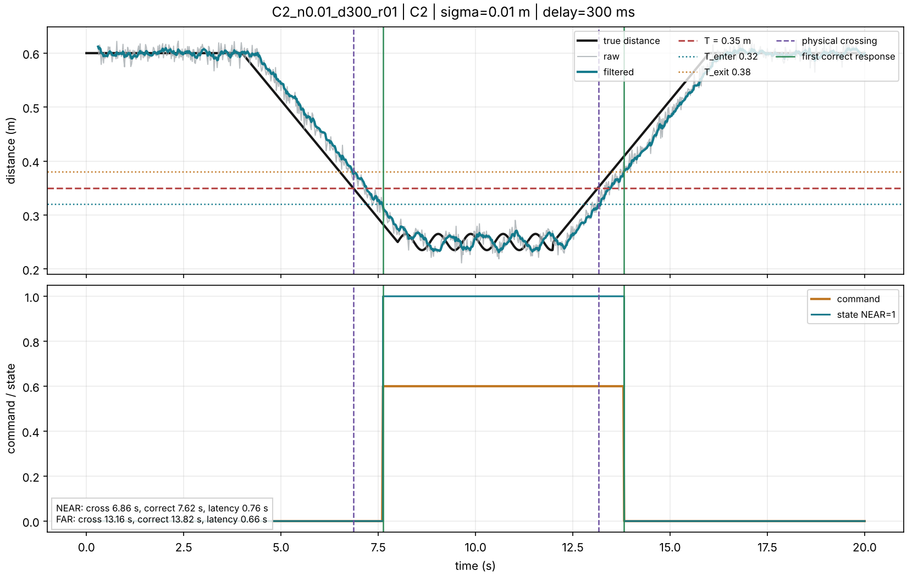
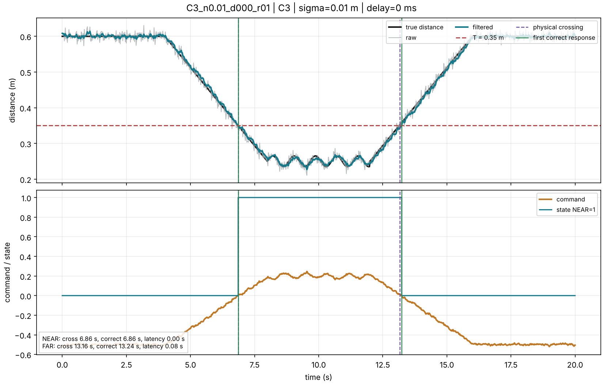

# Lab 02 — Robust Reactive Lamp: รายงานกลุ่ม 4

กลุ่ม: 4  
สมาชิก: ภูวเมศฐ์ กิตติธันยวัฒน์ 6752500126
วันที่ทดลอง: 12 พ.ย. 2026  
Python: 3.13 (รันซ้ำเพื่อเก็บหลักฐานด้วย 3.13.18)  
Controller SHA-256: `620f3938c710821f3a9e4d17d13a68623c916124f46bc29f048f213400b71cca` (จาก `evidence/student_comparison/run_config.json`)  
ขอบเขต: ผลจาก simulator เท่านั้น ไม่ใช่การทดลองกับ sensor หรือหุ่นยนต์จริง

## 1. คำถามและ prediction

คำถาม: noise และ delay ของระยะวัดมีผลต่อการสลับสถานะ false trigger และเวลาตอบสนองของ controller แบบใดบ้าง

Prediction (บันทึกตามจริง: เขียนประกอบหลังได้ผลแล้ว จึงไม่ใช่ preregistration ก่อนรัน):

| คำถามในใบงาน | Prediction | เหตุผล |
|---|---|---|
| noise เพิ่ม C1 switching count เปลี่ยนอย่างไร | เพิ่มขึ้น | C1 ใช้ raw distance กับ threshold เดียว ค่าที่แกว่งรอบ 0.35 m จึงข้ามไปมาได้หลายครั้ง |
| C2 ลด false trigger โดยแลกกับอะไร | false trigger ลดเกือบเป็น 0 แต่ latency และ recovery เพิ่ม | filter ทำให้สัญญาณช้าลง และ hysteresis ต้องรอให้ข้าม 0.32/0.38 m |
| delay 300 ms ทำให้การตอบสนองเลื่อนอย่างไร | เลื่อนช้าลงประมาณ 0.3 s | controller ได้ข้อมูลที่เก่ากว่าเหตุการณ์จริง 300 ms |

## 2. Block diagram ของ sensorimotor loop



ทางข้อมูล: มือ/คน (ระยะจริง) → sensor จำลอง (noise, delay, invalid) → ตรวจ sensor contract (valid และไม่เก่า) → C1 ใช้ raw distance; C2/C3 ใช้ low-pass filter β = 0.25 → controller → สถานะ NEAR/FAR และ command u → โคมไฟขยับเข้า/ออก ซึ่งเปลี่ยนสิ่งที่คนเห็นและระยะในรอบถัดไป (feedback). ข้อมูลใช้ไม่ได้ส่ง safe command u = 0 และบันทึก INVALID. C0 เป็น open loop ทำตามเวลา ไม่ใช้ sensor. ไฟล์ต้นฉบับแก้ได้: `evidence/diagram/sensorimotor_loop.mmd`

## 3. ผล comparison: noise 0.01 m, delay 0 ms, 5 trials/condition

ค่าทั้งหมดอ่านจาก `evidence/student_comparison/summary_aggregate.csv` (mean ± SD, n = 5)

| Controller | Trials | Latency enter (s) | Latency exit (s) | Recovery (s) | False trigger (/min) | Extra switches | Mean abs Δu | Invalid samples/trial |
|---|---:|---:|---:|---:|---:|---:|---:|---:|
| C0 open-loop | 5 | 0.003 ± 0.000 | 2.857 ± 0.000 | 2.857 ± 0.000 | 3.00 ± 0.00 | 0.0 ± 0.0 | 0.00120 ± 0.00000 | 0.0 ± 0.0 |
| C1 single threshold | 5 | 0.019 ± 0.026 | 0.029 ± 0.011 | 0.181 ± 0.059 | 8.39 ± 5.76 | 12.4 ± 2.6 | 0.00864 ± 0.00156 | 0.0 ± 0.0 |
| C2 filter + hysteresis | 5 | 0.407 ± 0.043 | 0.453 ± 0.036 | 0.454 ± 0.035 | 0.00 ± 0.00 | 0.0 ± 0.0 | 0.00120 ± 0.00000 | 0.0 ± 0.0 |
| C3 proportional + clamp | 5 | 0.043 ± 0.024 | 0.089 ± 0.041 | 0.109 ± 0.018 | 1.80 ± 1.64 | 1.6 ± 0.9 | 0.00465 ± 0.00006 | 0.0 ± 0.0 |

- Controller ที่เลือกทดสอบ robustness: **C2** เพราะเป็นแบบเดียวที่ false trigger = 0 และ extra switches = 0 ในชุดนี้ จึงเหมาะกับโคมไฟที่ไม่ควรสั่นไปมาต่อหน้าคน
- จำนวน invalid samples ใน comparison: **0** (ทั้ง 20 trials)
- จำนวน trial ที่ exclude: **0** — ไม่ตัด trial ใดและไม่แก้ raw CSV
- C0 เป็น open-loop: metric false trigger ของ C0 มาจากการทำงานตามเวลา ไม่ได้สะท้อนการอ่าน sensor

## 4. Robustness ของ C2 (ชุดเต็ม 3 noise × 3 delay × 5 trials = 45 trials)

ค่าอ่านจาก `evidence/c2_robustness_full/summary_aggregate.csv` (mean ± SD, n = 5 ต่อแถว)

| Noise σ (m) | Delay (ms) | Trials | Latency enter (s) | Latency exit (s) | Recovery (s) | False trigger (/min) | Extra switches | Invalid samples/trial |
|---:|---:|---:|---:|---:|---:|---:|---:|---:|
| 0.00 | 0 | 5 | 0.423 ± 0.000 | 0.417 ± 0.000 | 0.423 ± 0.000 | 0.00 ± 0.00 | 0.0 ± 0.0 | 0.0 ± 0.0 |
| 0.00 | 100 | 5 | 0.523 ± 0.000 | 0.517 ± 0.000 | 0.523 ± 0.000 | 0.00 ± 0.00 | 0.0 ± 0.0 | 5.0 ± 0.0 |
| 0.00 | 300 | 5 | 0.723 ± 0.000 | 0.717 ± 0.000 | 0.723 ± 0.000 | 0.00 ± 0.00 | 0.0 ± 0.0 | 15.0 ± 0.0 |
| 0.01 | 0 | 5 | 0.431 ± 0.050 | 0.417 ± 0.051 | 0.434 ± 0.046 | 0.00 ± 0.00 | 0.0 ± 0.0 | 0.0 ± 0.0 |
| 0.01 | 100 | 5 | 0.487 ± 0.043 | 0.537 ± 0.020 | 0.543 ± 0.014 | 0.00 ± 0.00 | 0.0 ± 0.0 | 5.0 ± 0.0 |
| 0.01 | 300 | 5 | 0.703 ± 0.065 | 0.713 ± 0.046 | 0.753 ± 0.009 | 0.00 ± 0.00 | 0.0 ± 0.0 | 15.0 ± 0.0 |
| 0.03 | 0 | 5 | 0.407 ± 0.033 | 0.353 ± 0.089 | 0.410 ± 0.028 | 0.00 ± 0.00 | 0.0 ± 0.0 | 0.0 ± 0.0 |
| 0.03 | 100 | 5 | 0.423 ± 0.117 | 0.477 ± 0.099 | 0.495 ± 0.088 | 0.00 ± 0.00 | 0.0 ± 0.0 | 5.0 ± 0.0 |
| 0.03 | 300 | 5 | 0.599 ± 0.093 | 0.605 ± 0.023 | 0.641 ± 0.048 | 0.00 ± 0.00 | 0.0 ± 0.0 | 15.0 ± 0.0 |

Invalid samples (5 ต่อ trial ที่ 100 ms, 15 ต่อ trial ที่ 300 ms) เกิดช่วงเริ่ม trial ที่ยังไม่มี sample ที่หน่วงครบเวลา จึงได้ safe command; ไม่ exclude trial ใด

> หมายเหตุการแก้ไข: รายงานฉบับก่อนมี 6 จาก 9 แถว และบันทึก invalid samples ของ 0.00 m/100–300 ms เป็น 0. ฉบับนี้รันชุดเต็มใหม่ในโหมด student และใช้ค่าจาก CSV ทั้งหมด

## 5. กราฟตัวแทน C1 และ C2

ทุกกราฟทำเครื่องหมาย **physical crossing** (เส้นประม่วง: ระยะจริงข้าม 0.35 m) และ **first correct response** (เส้นเขียว: state ตรงกับ expected ครั้งแรกหลัง crossing) สร้างด้วย `evidence/plot_with_markers.py` จาก raw CSV โดยไม่แก้ข้อมูล

| กราฟ | NEAR: crossing → correct | FAR: crossing → correct |
|---|---|---|
|  C1 trial 1 | 6.86 → 6.86 s (0.00 s) | 13.16 → 13.16 s (0.00 s) |
|  C2 trial 1 | 6.86 → 7.24 s (0.38 s) | 13.16 → 13.58 s (0.42 s) |
|  C2, delay 300 ms | 6.86 → 7.62 s (0.76 s) | 13.16 → 13.82 s (0.66 s) |
|  C3 trial 1 | 6.86 → 6.86 s (0.00 s) | 13.16 → 13.24 s (0.08 s) |

C1 ดู "ตอบทันที" (0.00 s) แต่กราฟแสดงว่า state สลับ NEAR/FAR หลายครั้งก่อนและหลัง crossing ทั้งสองครั้ง จึงต้องอ่านร่วมกับ extra switches และ recovery ไม่ใช่ latency อย่างเดียว

## 6. คำถามวิเคราะห์

1. **C1 กับ C2 ต่างกันด้าน extra switches และ latency เท่าใด** — extra switches: C1 = 12.4 ± 2.6 ครั้ง, C2 = 0.0 ครั้ง (ลด 12.4 ครั้ง/trial). latency enter: C1 = 0.019 s, C2 = 0.407 s (C2 ช้ากว่า 0.388 s). recovery: C1 = 0.181 s, C2 = 0.454 s (C2 ช้ากว่า 0.273 s). C2 แลกความนิ่งด้วยเวลาตอบสนองที่เพิ่มขึ้น
2. **noise 0.01 กับ 0.03 m ส่งผลต่อ metric ใดชัดที่สุด** — ใน C2 ค่าเฉลี่ย latency ไม่เพิ่มอย่างเป็นระบบ (delay 0 ms: 0.431 → 0.407 s) แต่ **ความแปรปรวน** เพิ่มชัดที่สุด: SD ของ latency exit ที่ delay 0 ms เพิ่มจาก 0.051 เป็น 0.089 s และ SD ของ latency enter ที่ delay 100 ms เพิ่มจาก 0.043 เป็น 0.117 s. false trigger และ extra switches ยังเป็น 0 ทุกแถว แปลว่า filter + hysteresis รับ noise 0.03 m ได้ในชุดนี้. ผลของ noise ต่อ C1 ไม่ได้วัดในชุด robustness (รันเฉพาะ C2) จึงไม่สรุป
3. **delay 300 ms ทำให้ latency เพิ่มใกล้ 300 ms หรือไม่** — ที่ noise 0: เพิ่มจาก 0.423 เป็น 0.723 s = **+0.300 s พอดี**. ที่ noise 0.01: +0.272 s และ noise 0.03: +0.192 s (มี SD ±0.09 s). กราฟ C2 delay 300 ms แสดง first correct response NEAR ที่ 7.62 s เทียบ 7.24 s ของ delay 0 (ช้ากว่า 0.38 s ใน trial ตัวแทนนี้). สรุป: delay เพิ่ม latency ประมาณเท่าค่า delay เมื่อไม่มี noise; เมื่อมี noise ผลรวมขึ้นกับจังหวะที่ noise ทำให้ filter ข้าม threshold เร็วหรือช้าลง
4. **C3 ชน command limit ช่วงใด และเหตุใด smoothness อย่างเดียวไม่พอ** — ในชุดนี้ **C3 ไม่ชน limit ±0.6 เลย** (0 จาก 1001 samples ทุก trial). command ต่ำสุด −0.53 ตอนมืออยู่ไกล 0.60 m ช่วง 0–4 s และสูงสุด +0.25 ตอนมืออยู่ใกล้ 0.25 m ช่วง 8–12 s (Kp × error = 2.0 × (0.35 − 0.61) ≈ −0.52). จะชน limit เมื่อระยะ > 0.65 m หรือ < 0.05 m. Smoothness (Mean |Δu| = 0.00465) อย่างเดียวไม่พอ เพราะ C3 ยังมี false trigger 1.80 /min และ extra switches 1.6 ครั้ง และ command ที่ "เรียบ" อาจยังผิดทิศหรือค้างที่ limit ได้; ต้องดูคู่กับ false trigger, recovery และเวลาที่ชน limit

## 7. วิธีทำงานและหลักฐาน

- เติม `student_controller.py`: first-order low-pass filter, single threshold, hysteresis, proportional command พร้อม clamp และ safe command ศูนย์สำหรับข้อมูลใช้ไม่ได้/เก่า
- `grade_submission.py`: 10/10 checks ผ่าน (`evidence/group4_grade.json`)
- Full test suite: 10/12 ผ่าน; 2 tests ที่ไม่ผ่านตั้งใจตรวจว่า starter ยังมี TODO จึงไม่ผ่านหลังทำเสร็จ ไม่ได้แก้ test ของผู้สอน

ไฟล์หลักฐานใน `lab_02/evidence/`:

| ไฟล์ | เนื้อหา |
|---|---|
| `group4_grade.json` | ผลตรวจ grader |
| `student_comparison/run_config.json` | config, seed, SHA-256 ของ controller |
| `student_comparison/summary_trials.csv`, `summary_aggregate.csv` | metric ราย trial และสรุป |
| `student_comparison/trials/*.csv` | raw CSV ทั้ง 20 trials |
| `c2_robustness_full/...` | config, summary และ raw CSV ทั้ง 45 trials |
| `plots/*.png` | กราฟ C1, C2, C3 และ C2 delay 300 ms |
| `diagram/sensorimotor_loop.png` / `.mmd` | block diagram |

คำสั่งทำซ้ำจากโฟลเดอร์ `lab_02`:

```powershell
py -3 grade_submission.py --student-file student_controller.py --out evidence\group4_grade.json
py -3 lab02.py --controller-source student --student-file student_controller.py --protocol controller-comparison --out evidence\student_comparison
py -3 lab02.py --controller-source student --student-file student_controller.py --protocol robustness-full --condition C2 --out evidence\c2_robustness_full
py -3 evidence\plot_with_markers.py evidence\student_comparison\trials\C1_n0.01_d000_r01.csv --out evidence\plots\C1_n0.01_d000_r01.png
py -3 evidence\plot_with_markers.py evidence\student_comparison\trials\C2_n0.01_d000_r01.csv --out evidence\plots\C2_n0.01_d000_r01.png
```

## 8. สรุปและข้อจำกัด

ใน proposed course model นี้ filter + hysteresis (C2) ทำให้ extra switches และ false trigger เป็น 0 แต่ช้ากว่า C1 ประมาณ 0.39 s; proportional control (C3) ลดการสลับลงแต่ไม่กำจัด false trigger. delay เพิ่ม latency ประมาณเท่าค่า delay. ผลนี้ไม่ยืนยันความถูกต้องของ sensor จริง ความปลอดภัย ความเสถียร การใช้พลังงาน หรือความเหมาะสมของ threshold บน hardware. simulator ไม่มีพลวัตของแขนโคม ไม่มีการหน่วงของมอเตอร์ และใช้ noise แบบ Gaussian ที่อาจต่างจาก sensor จริง. ก่อนใช้จริงต้องตรวจ datasheet, calibration, หน่วยและช่วง actuator, safe command และ emergency stop
