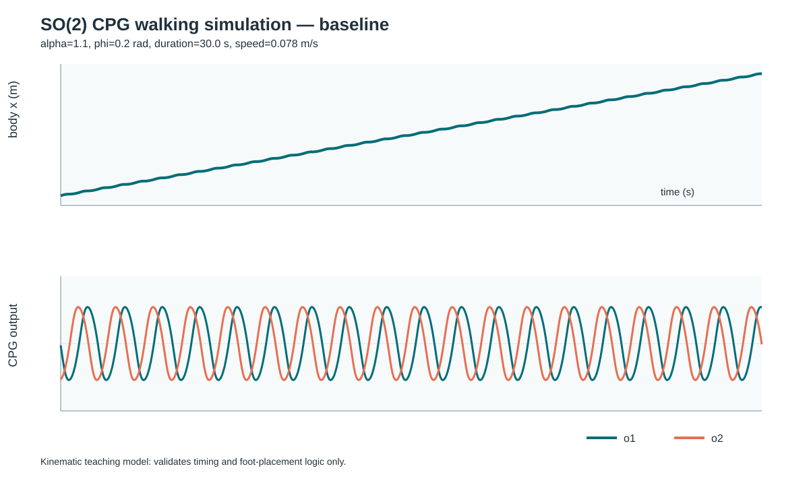
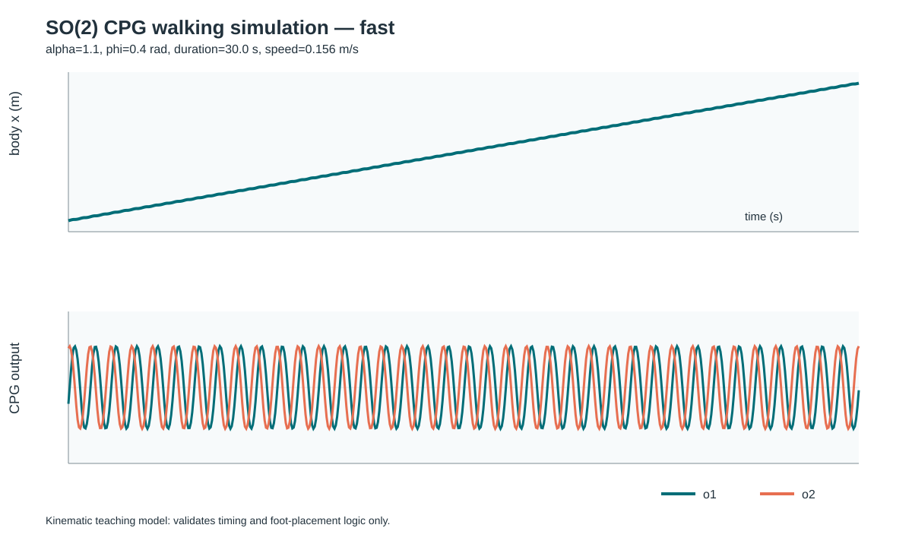

# ใบงาน Lab 03 — SO(2) CPG และการเดินหุ่นยนต์หกขา (กรอกแล้ว)

กลุ่ม: 4  
สมาชิก: ภูวเมศฐ์ กิตติธันยวัฒน์ (6752500126), _(เติมชื่อและรหัสสมาชิกคนอื่น)_  
วันที่ทดลอง: 12 พ.ย. 2026  
ขอบเขต: ทุกผลในเอกสารนี้มาจาก kinematic simulator ของรายวิชา ไม่ใช่การทดลองกับหุ่นยนต์จริง

## 1. Prediction และสมการ

Prediction จากสมการ (เขียนประกอบหลังได้ผลแล้ว จึงไม่ใช่ preregistration): เพิ่ม φ ควรเร่งการเปลี่ยนเฟสและเพิ่มความถี่/ความเร็ว; เพิ่ม α ควรเพิ่ม amplitude/clearance แต่ผลความถี่ไม่จำเป็นต้องเพิ่ม เพราะ tanh ทำให้ระบบไม่เชิงเส้น. Tripod A (`LF, RM, LH`) กับ Tripod B (`RF, LM, RH`) ถูกถอดรหัสด้วยเครื่องหมายตรงข้าม จึงทำงานแบบสลับกัน.

| ข้อในใบงาน | คำตอบ |
|---|---|
| 1. เพิ่ม φ จาก 0.20 เป็น 0.40 rad ความถี่ที่วัดได้จะ | เพิ่มขึ้น เพราะ φ คือมุมที่ state หมุนต่อ 1 step ยิ่งมากยิ่งครบรอบเร็ว |
| 2. เพิ่ม α จาก 1.10 เป็น 1.30 แอมพลิจูดและ foot clearance จะ | เพิ่มขึ้น เพราะ gain สูงทำให้ tanh อิ่มตัวใกล้ ±1 มากขึ้น และ lift = lift_height × max(0, ±o₂) |
| 3. Tripod A กับ Tripod B ควรมี phase relation | ตรงข้ามกัน 180° (π rad): decoder ใช้ sign +1 กับ −1 บน o₂ ตัวเดียวกัน |

สมการใช้ค่ารอบเก่าทั้งคู่:

```text
a1 = α(cosφ·o1 + sinφ·o2)
a2 = α(−sinφ·o1 + cosφ·o2)
o1_next = tanh(a1)
o2_next = tanh(a2)
```

เมื่อ `o1=.10`, `o2=−.20`, `α=1.10`, `φ=.20 rad`:

| ค่า | ผลคำนวณ |
|---|---:|
| a1 | 0.064100 |
| a2 | −0.237468 |
| o1_next | 0.064012 |
| o2_next | −0.233103 |

การ implement เก็บ `old_o1, old_o2` ก่อนคำนวณ จึงไม่มีการใช้ค่ารอบใหม่ข้ามสมการ.

## 1.5 ขั้นทดลอง A: Visual exploration (`hexapod_cpg_sim.html`)

ปรับทีละ slider จาก baseline (α = 1.10, φ = 0.20 rad, stride = 0.055 m) แล้วปล่อยให้เดิน 27.1 s ที่ simulation speed 3× อ่านค่าจากแผงตัวเลขของ simulator. ภาพหน้าจอเก็บใน `evidence/visual_exploration/`

| Slider ที่เปลี่ยน | ระยะทาง (m) | ความเร็วเฉลี่ย (m/s) | ความถี่ CPG (Hz) | ขารองรับ | สิ่งที่สังเกต |
|---|---:|---:|---:|---:|---|
| ไม่เปลี่ยน (baseline) | 2.098 | 0.077 | 0.625 | 3/6 | สอง tripod สลับกันสม่ำเสมอ |
| φ = 0.40 rad | 4.193 | 0.155 | 1.272 | 3/6 | คลื่น o₁/o₂ ถี่ขึ้นประมาณ 2 เท่า ขาสลับเร็วขึ้น |
| α = 1.30 | 2.572 | 0.095 | 0.545 | 3/6 | คลื่นเป็นทรงเหลี่ยมขึ้น (tanh อิ่มตัว) ความถี่ลดลง แต่ยกเท้าสูงขึ้น |
| stride = 0.075 m | 2.836 | 0.105 | 0.625 | 3/6 | ความถี่เท่าเดิม แต่ก้าวยาวขึ้นจึงเดินได้ไกลขึ้น |

ค่าจาก visual simulator ใช้สำรวจเท่านั้น ผลหลักใช้ batch experiment ในส่วนที่ 2 ซึ่งทำซ้ำได้

## 2. ผล gait comparison

ใช้ dt=.05 s, duration=30 s, warmup=10 s และเปลี่ยนทีละ parameter:

| Condition | α | φ (rad) | Speed (m/s) | Frequency (Hz) | Duty factor LF | Min support | Clearance (mm) |
|---|---:|---:|---:|---:|---:|---:|---:|
| baseline | 1.10 | .20 | .077756 | .625000 | .494176 | 3 | 17.095 |
| fast | 1.10 | .40 | .155511 | 1.267123 | .500832 | 3 | 17.113 |
| high_gain | 1.30 | .20 | .094457 | .544218 | .494176 | 3 | 24.637 |

เมื่อเพิ่ม φ เป็น .40 ความเร็วประมาณสองเท่าและความถี่เพิ่มจาก .625 เป็น 1.267 Hz; clearance แทบไม่เปลี่ยน. เมื่อเพิ่ม α ความเร็วเพิ่ม แต่ความถี่ลดเป็น .544 Hz และ clearance เพิ่ม 7.542 mm. ทุกกรณี decoder รายงาน support ต่ำสุด 3 ขา; นี่ไม่ยืนยัน dynamic stability เพราะไม่มี rigid-body dynamics, contact force, friction, CoM/support polygon, torque หรือ energy model.

ผลตรวจ `grade_submission.py`: 5/5 checks ผ่าน.

## 3. Week 4 handoff

Manual bounded input: `phi=clamp(.20+.20m,.10,.45)` rad, `stride_half=clamp(.055+.010m,.040,.070)` m.

| ช่วงเวลา | m | φ (rad) | stride_half (m) | Mean speed (m/s) | Frequency (Hz) | Min support |
|---|---:|---:|---:|---:|---:|---:|
| 0–10 s | 0 | .20 | .055 | .077632 | .625000 | 3 |
| 10–20 s | 1 | .40 | .065 | .183294 | 1.263158 | 3 |
| 20–30 s | 0 | .20 | .055 | .077387 | .625000 | 3 |

เมื่อ m กลับเป็น 0 คำสั่ง phi/stride กลับค่า baseline ทันทีตาม mapping; output oscillator และความเร็วอาจยังมี transient จาก state ก่อนหน้า. Week 4 จะใช้ hormone/receptor output แทน manual m แต่ Lab 03 ยังไม่ได้จำลอง hormone.

### คำถาม handoff

1. **เหตุใด mapping ต้องมี bounds?** — เพื่อให้คำสั่งที่ส่งต่อไป CPG อยู่ในช่วงที่ทดสอบแล้วเสมอ แม้ค่าต้นทาง (m หรือ hormone) จะผิดพลาด ชนขอบ หรือเป็น spike: φ ต้องอยู่ใน 0.10–0.45 rad (ไม่ช้าจนหยุดหรือเร็วจนข้อต่อตามไม่ทัน) และ stride_half ต้องอยู่ใน 0.040–0.070 m (ไม่ก้าวเกินระยะที่ขาทำได้). Bounds แยกความผิดพลาดของ slow state ออกจาก motor command
2. **ใน Week 4 ตัวแปรใดจะมาแทน m(t)?** — receptor output R(t) ที่ได้จาก hormone concentration H(t) (`handoff_contract.json` ระบุ `replace with hormone concentration in Week 4`)
3. **ถ้า hormone เปลี่ยนช้ากว่า CPG คาดว่าจะเห็น transient อย่างไร?** — φ และ stride จะค่อย ๆ เพิ่ม/ลดตาม H แทนการกระโดดทันทีแบบ manual m ในตารางข้างบน ความถี่และความเร็วจะไต่ขึ้นช้า ๆ ภายในช่วง 10–20 s และหลัง stimulus หาย (20 s) จะยังเร็วกว่า baseline ไปอีกช่วงหนึ่งจนกว่า H จะสลายกลับ. ใน run นี้ m กระโดดตรง ส่วน 20–30 s ความถี่กลับเป็น 0.625 Hz ทันที แต่ความเร็วเฉลี่ย 0.077387 m/s ยังต่ำกว่าช่วง 0–10 s (0.077632 m/s) เล็กน้อยจากเฟสของ oscillator ตอนเปลี่ยน

## 3.5 คำถามวิเคราะห์ (ข้อ 12 ในคู่มือ)

1. **fast ต่างจาก baseline เท่าใด** — frequency 1.267123 − 0.625000 = +0.642 Hz (×2.03); speed 0.155511 − 0.077756 = +0.077755 m/s (×2.00)
2. **high_gain เปลี่ยน clearance และ frequency ทิศเดียวกันหรือไม่** — ไม่: clearance เพิ่ม 17.095 → 24.637 mm (+7.542 mm) แต่ frequency ลด 0.625 → 0.544 Hz (−0.081 Hz)
3. **support legs ต่ำกว่า 3 หรือไม่ และกฎใดเป็นสาเหตุ** — ไม่ต่ำกว่า 3 ทุก condition (min = max = 3). สาเหตุคือกฎ contact ใน decoder: `contact = sign × o₂ ≤ 0` โดย Tripod A ใช้ sign = +1 และ Tripod B ใช้ sign = −1 บน o₂ ตัวเดียวกัน จึงมี tripod หนึ่งแตะพื้นเสมอ (ถ้า o₂ = 0 พอดีจะแตะทั้ง 6 ขา)
4. **เมื่อ m กลับจาก 1 เป็น 0 output กลับ baseline ทันทีหรือมี transient** — คำสั่ง φ/stride กลับทันทีเพราะ mapping เป็นฟังก์ชันตรง แต่ oscillator ต้องเปลี่ยนเฟสต่อจาก state เดิม จึงมี transient เล็กน้อยในความเร็ว (ดูข้อ 3 ข้างบน)
5. **ทำไม Week 4 ควรส่ง hormone ผ่าน receptor และ bounded mapping** — receptor เลือกว่า H มีผลกับ target ใดและแรงเท่าไร ส่วน bounded mapping กันไม่ให้ค่า H ที่ผิดปกติกลายเป็นคำสั่งเกินช่วงที่ปลอดภัย การสั่งมอเตอร์ตรงจาก H จะข้ามทั้งสองชั้นนี้
6. **ถ้าต้องพิสูจน์ dynamic stability ต้องเพิ่ม model และ metric ใด** — ต้องเพิ่ม rigid-body dynamics, มวล/ความเฉื่อยของลำตัวและขา, contact force และ friction, torque limit ของมอเตอร์. Metric ที่ต้องวัด: ระยะ CoM ถึงขอบ support polygon (stability margin), ground reaction force ต่อขา, การลื่น (slip), roll/pitch ของลำตัว และพลังงาน/กระแสมอเตอร์ — บนหุ่นจริงต้องมี IMU และ force sensor

## 4. ข้อสรุปและข้อจำกัด

ข้อมูลสนับสนุนว่า φ เป็นตัวปรับจังหวะหลักในโมเดลนี้ ส่วน α เปลี่ยน clearance และมีผลไม่เชิงเส้นต่อ frequency. ผลความเร็วเป็นการเคลื่อนที่ที่กำหนดจาก CPG/decoder ไม่ใช่ผลของหุ่นยนต์จริงหรือการวัดแรงสัมผัส. ค่า α, φ, stride และ lift เป็น proposed course model; ไม่ใช่ค่าจาก paper หรือค่าปลอดภัยสำหรับ hardware.

หลักฐานและคำสั่งทำซ้ำ:

```powershell
py -3 grade_submission.py --student-file student_cpg.py --out evidence\group4_grade.json
py -3 cpg_walk_sim.py --condition all --output-dir evidence\gait_comparison
py -3 week4_bridge.py --output-dir evidence\week4_bridge
```

ไฟล์หลักฐานใน `lab_03/evidence/` (อยู่ใน repo):

| ไฟล์ | เนื้อหา |
|---|---|
| `group4_grade.json` | grader 5/5 |
| `gait_comparison/conditions_summary.csv` | summary ครบ 3 conditions |
| `gait_comparison/{baseline,fast,high_gain}.csv` | raw CSV ราย condition |
| `gait_comparison/{baseline,fast,high_gain}.svg` | กราฟตัวแทน 3 เงื่อนไข |
| `week4_bridge/week4_bridge.csv`, `handoff_contract.json` | Week 4 handoff (baseline, gain, bounds, fixed parameters) |
| `visual_exploration/*.png` | ภาพหน้าจอขั้นทดลอง A |

`student_cpg.py` มี SO(2) simultaneous update, tripod decoder และ bounded modulation ครบ.

กราฟตัวแทน:



