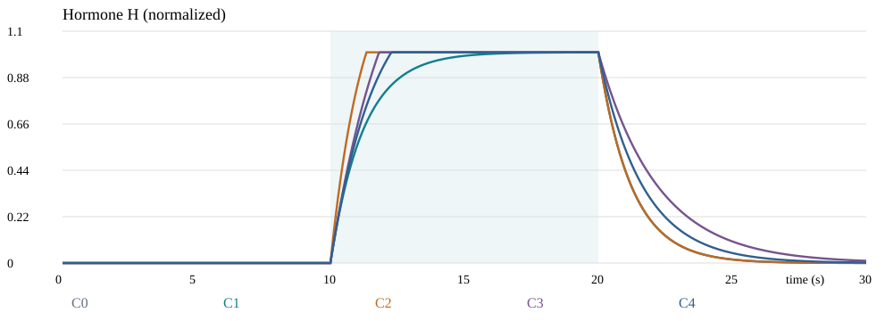

# ใบงาน Lab 04 — Artificial Hormone Mechanism (กรอกแล้ว)

กลุ่ม: 4  
สมาชิก: ภูวเมศฐ์ กิตติธันยวัฒน์ 6752500126 
วันที่ทดลอง: 12 พ.ย. 2026  
Python version: 3.13 (ชุดหลักฐานรันซ้ำด้วย 3.13.18)  
Code version: branch `กลุ่ม4` ของ repo กลุ่ม  
Controller SHA-256: `cec3cc9d6e37e9a89e244da574602b1c2fcc7b105c40ec84fbefdce732ab6f6b`; runner SHA-256: `4acf68979cde5f086e41f82cc5137ab7bac49026184032a2e7ac4943c1abacb4` (จาก `evidence/comparison/config.json`)  
ขอบเขต: proposed course model ใน simulator; ไม่มีการทดลองกับหุ่นยนต์จริง

## A. กลไกและ prediction

`S → production P; H_old → clearance C และ receptor R_old → binding B; H_new → R_new → bounded phi/stride`. Prediction จากสมการ (เขียนประกอบหลังได้ผลแล้ว ไม่ใช่ preregistration): เพิ่ม production น่าจะเพิ่ม AUC/ทำให้อิ่มตัวเร็วขึ้น; ลด clearance น่าจะทำให้ recovery ช้าลง; ตัด binding น่าจะเพิ่ม AUC/recovery; direct C0 ไม่มีสถานะ H. ค่า H มี upper bound 1 จึงอาจทำให้ peak ของหลาย condition เท่ากัน.

**สมการ source** (Homchanthanakul et al., 2019, IROS, DOI 10.1109/IROS40897.2019.8968580, equations 2–5 ตามที่สไลด์ Week 04 อ้าง):

```text
Hc(t) = β·Hc(t−1) + Hg(t) − Hr(t)
```

β = retention factor (ส่วนที่คงเหลือจาก step ก่อน), Hg = ส่วนที่ gland สร้างจาก stimulus, Hr = ส่วนที่ receptor ดึงออก. เป็น discrete recurrence ตาม index t ไม่มี dt

**สมการ proposed course model** (ใช้ใน Lab) เป็น Euler แยก dt ชัดเจน; หน่วย: k_prod เป็น normalized H/s, k_clear เป็น s⁻¹, k_bind เป็น normalized H/s ต่อหน่วย R, dt = 0.05 s:

```text
R_old = clamp((H_old - H_min)/(H_max - H_min), 0, 1)
P = k_prod*S; C = k_clear*H_old; B = k_bind*R_old
H_raw = H_old + dt*(P-C-B)
H_new = clamp(H_raw,0,1); R_new = receptor(H_new)
phi = clamp(.20+.20*R_new,.10,.45)
stride_half = clamp(.055+.010*R_new,.040,.070)
```

Block diagram (ลูกศรบอกผลของบล็อกก่อนหน้า):

```text
S(t) --[เพิ่มอัตราผลิต]--> P = k_prod·S --[+]--> H(t) <--[−]-- C = k_clear·H_old
                                                 ^ <--[−]-- B = k_bind·R_old
H(t) --[normalize + clamp]--> R(t) --[bounded mapping]--> φ = clamp(.20+.20R, .10, .45) rad
                                                    \--> stride_half = clamp(.055+.010R, .040, .070) m
```

| เปรียบเทียบ | Prediction (เขียนหลังได้ผล ไม่ใช่ preregistration) | เหตุผลจาก term | ผลจริงหลังรัน |
|---|---|---|---|
| C2 กับ C1 | ขึ้นเร็วกว่า AUC มากกว่า | P = k_prod·S ใหญ่ขึ้น (0.8 → 1.2) | latency .10 vs .15 s, rise 1.05 vs 2.70 s, AUC 10.67 vs 10.00 — **สนับสนุน** |
| C3 กับ C1 | ฟื้นช้ากว่า AUC มากกว่า | C = k_clear·H เล็กลง (0.6 → 0.25) | recovery 5.10 vs 2.85 s (+2.25 s), AUC 11.39 — **สนับสนุน** |
| C4 กับ C1 | steady state สูงกว่า ฟื้นช้ากว่า | ไม่มี B = k_bind·R ช่วยลด | recovery 3.80 vs 2.85 s, AUC 10.75 — **สนับสนุน**; steady state สูงกว่าแต่ชน clamp 1.0 จึงเห็นเป็น clamp fraction .2583 แทน |
| C0 กับ C1 | ตอบทันที ไม่มี memory | R = S ไม่มี H | latency .05 s, recovery .05 s, phi TV .400 — **สนับสนุน** |

Prediction ที่เปลี่ยนเมื่อ H ชน upper bound 1: "peak H สูงขึ้น" ของ C2/C3/C4 ใช้แยกไม่ได้ เพราะทุกตัวถูก clamp ที่ 1.0 เท่ากัน ต้องดู AUC, rise, recovery และ clamp fraction แทน

ตัวอย่าง receptor: `H=.2, H_min=.1, H_max=.5` ให้ `R=.25`; ค่านอกช่วงถูก clamp เป็น 0/1 และ range ไม่ถูกต้อง/nonfinite ถูกปฏิเสธ.

## B. คำนวณสอง update แรก

สำหรับ C1: `dt=.05`, `k_prod=.8`, `k_clear=.6`, `k_bind=.2`, `S=1`.

| input time (s) | state time (s) | P | C | B | H_raw | H_new | R_new | φ (rad) | stride_half (m) |
|---:|---:|---:|---:|---:|---:|---:|---:|---:|---:|
| 10.00 | 10.05 | .8000 | .0000 | .0000 | .0400 | .0400 | .0400 | .20800 | .055400 |
| 10.05 | 10.10 | .8000 | .0240 | .0080 | .0784 | .0784 | .0784 | .21568 | .055784 |

`input_time_s` คือเวลาต้น interval ส่วน `time_s` คือเวลาหลัง update; แถวเวลา 10.00 ใช้ stimulus ที่ 10.00 และสร้าง state เวลา 10.05.

## C. Controlled comparison

| Condition | peak H | AUC H (normalized H·s) | latency (s) | rise 10–90% (s) | recovery (s) |
|---|---:|---:|---:|---:|---:|
| C0 direct | N/A | N/A | .05 | 0.00 | .05 |
| C1 baseline | .999715 | 9.999644 | .15 | 2.70 | 2.85 |
| C2 production สูง | 1.000000 | 10.672410 | .10 | 1.05 | 2.85 |
| C3 clearance ต่ำ | 1.000000 | 11.389145 | .15 | 1.45 | 5.10 |
| C4 binding=0 | 1.000000 | 10.754720 | .15 | 1.70 | 3.80 |

| Condition | upper clamp fraction | phi TV (rad) | stride TV (m) | fault count |
|---|---:|---:|---:|---:|
| C0 direct | N/A (ไม่มี H) | .400000 | .020000 | 0 |
| C1 baseline | .0000 | .399829 | .019991 | 0 |
| C2 production สูง | .2900 | .399943 | .019997 | 0 |
| C3 clearance ต่ำ | .2733 | .397890 | .019894 | 0 |
| C4 binding=0 | .2583 | .399548 | .019977 | 0 |

ค่าจาก `evidence/comparison/metrics.csv` (run ซ้ำได้ค่าตรงกับรอบแรกทุกตัว)

**เหตุใดต้องคง dt, stimulus และ mapping เหมือนกันทุก condition** — เพื่อให้ความต่างของผลมาจาก parameter ที่ตั้งใจเปลี่ยนเพียงตัวเดียว (controlled comparison). ถ้าเปลี่ยน dt ค่า rate ต่อ step จะเปลี่ยนตาม ถ้าเปลี่ยน stimulus จุดเริ่ม-จบของการวัดจะต่างกัน และถ้าเปลี่ยน mapping คำสั่ง φ/stride จะต่างแม้ H เท่ากัน ทำให้ระบุสาเหตุไม่ได้

C3 ฟื้นช้ากว่า C1 `5.10−2.85=2.25 s`. C2 และ C3 peak เท่ากับ 1 เพราะ bounded state อิ่มตัว; AUC, rise, recovery และ clamp fraction แยกระบบได้ดีกว่า peak อย่างเดียว. C0 ไม่มี H state จึงไม่ควรกรอก peak/AUC เป็นศูนย์. C0 เป็น direct path; latency .05 s คือความละเอียด post-update ของ log ไม่ใช่ hardware delay. TV ต่ำ/สูงเพียงค่าเดียวไม่พิสูจน์คุณภาพ gait.

## D. Extreme inputs และ fault

- `zero`: S=0 ตลอด; H คง baseline 0.
- `one`: S=1 ตลอด; H ถูกจำกัดไม่เกิน 1.
- `spike`: S=1 หนึ่ง sample (.05 s) แล้วกลับ 0; เป็น pulse สั้น ไม่ใช่ sustained stimulus.
- `fault`: มี invalid input 1 ครั้งที่ input_time 15.00 s; fault row จบ state ที่ 15.05 s ด้วย `H=R=0`, `phi=.20`, `stride=.055`. Update 15.05→15.10 s เริ่มสะสมใหม่ ได้ H=.04, R=.04.

- `spike`: on interval **1 แถว** (input_time 10.00 s) นาน **0.05 s**; H สูงสุด .04 แล้วสลายกลับ ไม่ถึง threshold ใด
- `fault` หลักฐานจาก `evidence/extreme_fault/C1_fault.csv`: แถวก่อน fault (input 14.95 → state 15.00) H = .983130, φ = .396626; แถว fault (input 15.00, stimulus = nan → state 15.05) fault = 1, H = R = 0, φ = .20, stride = .055; แถวถัดไป (input 15.05 → 15.10) H = .04 และ 15.15 → .0784 — **reset แล้วกลับมาสะสมได้**

การตรวจ bounded mapping ด้วย `handoff_contract.json` ที่แจก:

| R | φ (rad) | stride_half (m) | อยู่ใน bounds หรือไม่ |
|---:|---:|---:|---|
| 0 | .20 | .055 | อยู่ (.10–.45 / .040–.070) |
| 1 | .40 | .065 | อยู่ (.10–.45 / .040–.070) |

Contract ที่ใช้: `lab_04/handoff_contract.json` — ตรวจแล้ว ☑ ตรงเดิม (alpha = 1.10, dt = .05, lift = .03); runner ตรวจ contract ก่อนรันทุกครั้งและรันผ่านโดยไม่มีข้อความแจ้งเตือน

**Software bounds ต่างจาก actuator limits และ emergency stop อย่างไร** — software bounds คือ clamp ในโค้ดที่จำกัดคำสั่ง φ/stride ให้อยู่ในช่วงที่กำหนด แต่ถ้าโค้ดค้าง ผิด หรือคำสั่งไม่ถึง motor ก็ป้องกันอะไรไม่ได้. actuator limits อยู่ที่ตัวมอเตอร์/ไดรเวอร์ (มุม ความเร็ว กระแส อุณหภูมิ) ส่วน emergency stop ตัดพลังงานจริงได้โดยไม่พึ่งโค้ด ต้องมีทั้งสามชั้น

**Lab04 ยังไม่ได้ทดสอบสิ่งใด และต้องเก็บหลักฐานใดเพิ่ม** — ยังไม่ได้รัน CPG หรือวัด body motion/gait, ไม่มี sensor จริง, ไม่มี noise/delay ของ stimulus และไม่มี hardware. ก่อนอ้างกับหุ่นจริงต้องเก็บ: log ของ H/R/command คู่กับ motion จริง (encoder/IMU/กล้อง), latency ของ sensor จริง, การตอบสนองต่อ fault จริง และผลการสอบเทียบ actuator

Fallback/reset ทำก่อนคำนวณ command ของ interval fault ตาม software policy. มันไม่แทน emergency stop, sensor diagnostics, actuator bounds หรือ hardware safety assessment.

## E. สรุปและหลักฐาน

ผลสนับสนุนว่าการเปลี่ยน production/clearance/binding เปลี่ยน transient และ AUC; การ clamp ทำให้ peak อย่างเดียวแยก C2/C3 ไม่ได้. ทั้งหมดเป็น deterministic simulation และไม่ได้เชื่อม CPG/body motion ใน Lab04.

`check_submission.py`: 13/13 cases ผ่าน. ไฟล์หลักฐานใน `lab_04/evidence/` (อยู่ใน repo):

| ไฟล์ | เนื้อหา |
|---|---|
| `check_submission_output.json` | checker 13/13 |
| `comparison/C0_step.csv` … `C4_step.csv` | comparison CSV 5 ไฟล์ |
| `extreme_{zero,one,spike,fault}/C1_*.csv` | extreme CSV 4 ไฟล์ |
| `*/config.json` | config ทุกชุดทดลอง (มี SHA-256) |
| `comparison/metrics.csv`, `metrics.json` | metric table |
| `comparison/h.svg`, `r.svg`, `phi_rad.svg`, `stride_half_m.svg`, `report.html` | กราฟ |

 `student_hormone.py` ใช้ค่าเก่า P/C/B ก่อนคำนวณ H ใหม่และตรวจ invalid stimulus.

```powershell
py -3 check_submission.py --student-file student_hormone.py
py -3 lab04.py --controller-source student --condition all --profile step --output-dir evidence\comparison
py -3 lab04.py --controller-source student --condition C1 --profile zero --output-dir evidence\extreme_zero
py -3 lab04.py --controller-source student --condition C1 --profile one --output-dir evidence\extreme_one
py -3 lab04.py --controller-source student --condition C1 --profile spike --output-dir evidence\extreme_spike
py -3 lab04.py --controller-source student --condition C1 --profile fault --output-dir evidence\extreme_fault
```

อัตรา, bounds และ mapping เป็น proposed course model. ผลนี้ไม่ใช่ reproduction หรือ validation ของสมการ/ผลหุ่นยนต์ใน paper และไม่พิสูจน์ความปลอดภัยหรือ dynamic stability.
