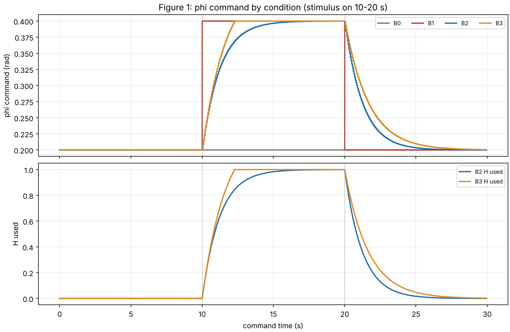
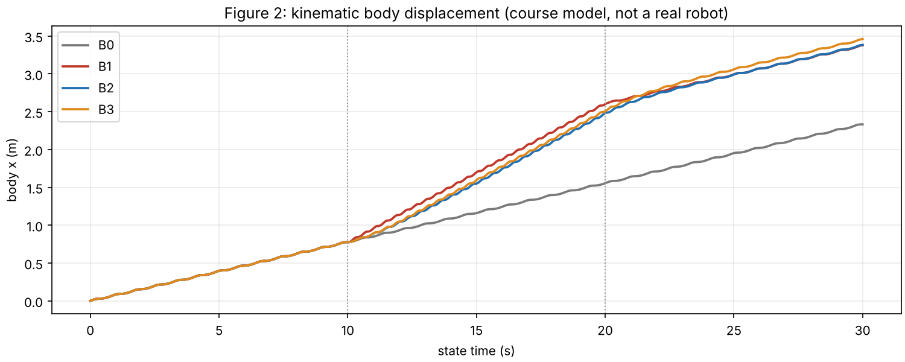

# ใบงาน Lab 05 — Prediction, timing, evidence (กรอกแล้ว)

กลุ่ม: 4  
สมาชิก: ภูวเมศฐ์ กิตติธันยวัฒน์ (6752500126), _(เติมชื่อและรหัสสมาชิกคนอื่น)_  
วันที่ทดลอง: 12 พ.ย. 2026  
Python: 3.13 (ชุดหลักฐานรันซ้ำด้วย 3.13.18); ทุก output directory มี `config.json`, `manifest.json` (SHA-256) และ `source_snapshot/`  
ขอบเขต: ทุกตัวเลขเป็นผล proposed course model / synthetic contact demo ไม่ใช่การทดลองบนหุ่นยนต์จริงหรือการทำซ้ำ paper

## 1. Architecture และ prediction

`S → hormone controller → R_used → bounded phi/stride → SO(2) CPG → tripod decoder → kinematic body`. Main runner ไม่มี independent sensory/contact-force feedback; support/contact คำนวณจาก decoder ของ oscillator.

Prediction จากสมการ (เขียนประกอบหลังได้ผลแล้ว ไม่ใช่ preregistration): B2 ซึ่งใช้ H/R ที่สะสมควรมี command เปลี่ยนเรียบกว่าการ direct input B1; B3 ตัด binding term จึงควรเปลี่ยน AUC/recovery; phi-only ควรเปลี่ยนจังหวะโดยคง stride; stride-only ควรเปลี่ยนระยะก้าวโดยคง phi.

Hypothesis B1 เทียบ B2 (metric/หน่วย/ทิศทาง): B2 จะมี **max Δφ/step (rad) ต่ำกว่า** B1 อย่างน้อย 10 เท่า และ **command recovery (s) นานกว่า** B1 เพราะ H สะสมและสลายตาม k_prod/k_clear แทนการตาม S ทันที. ผล: max Δφ/step .008 vs .200 rad (ต่ำกว่า 25 เท่า), recovery 2.85 vs .00 s — สนับสนุน

Provenance: สมการ SO(2) มีที่มาจากเอกสาร Week03; AHM จากเอกสาร Week04/paper ที่คู่มืออ้าง; Euler rates, constants, bounds และ simplified `R=H` เป็น proposed course model. วัดได้: command, oscillator crossings, kinematic distance, clamp/fault counters. วัดไม่ได้: dynamic stability, energy, torque, real contact force หรือ paper Harmony/Stability/Displacement.

## 2. Timing ของ B2

| command/input (s) | state end (s) | H_start | H_end | R_used | φ command (rad) | stride_half command (m) |
|---:|---:|---:|---:|---:|---:|---:|
| 10.00 | 10.05 | .000000 | .040000 | .000000 | .200000 | .055000 |
| 10.05 | 10.10 | .040000 | .078400 | .040000 | .208000 | .055400 |
| 20.00 | 20.05 | .999715 | .959727 | .999715 | .399943 | .064997 |

B1 เป็น direct algebraic path: command ใช้ S ที่ 10.00 ได้ทันที แต่ state logger เป็น post-update จึงเห็น state ใหม่ที่ 10.05; ความต่าง 0.05 s เป็น log/update convention ไม่ใช่ network หรือ hardware latency. ทุก condition ใช้ oscillator ที่ผ่าน warmup 10 s ด้วย phi=.20 จาก initial oscillator เดียวกัน; H/R, body origin, anchors และ log origin ถูก reset โดยยังเก็บ oscillator หลัง warmup.

## 3. Main comparison

| Condition | φ TV (rad) | max Δφ/step (rad) | stride TV (m) | command latency (s) | recovery (s) | on frequency (Hz) | on distance (m) |
|---|---:|---:|---:|---:|---:|---:|---:|
| B0 fixed | .000000 | .000000 | .000000 | N/A | N/A | .624877 | .778743 |
| B1 direct | .400000 | .200000 | .020000 | .00 | .00 | 1.268366 | 1.825152 |
| B2 hormone | .399827 | .008000 | .019991 | .15 | 2.85 | 1.202760 | 1.706250 |
| B3 binding ablation | .399534 | .008000 | .019977 | .15 | 3.80 | 1.225791 | 1.727498 |

ระยะรวมตลอด 30 s: B0=2.332679 m, B1=3.377516 m, B2=3.382580 m, B3=3.460133 m. B2/B3 มี max φ step ต่ำกว่า B1 (.008 เทียบ .2 rad) แม้ total variation ใกล้กัน; TV รวมตลอด run จึงไม่ใช่ตัวแทนของความเรียบเฉพาะช่วงหรือความปลอดภัย. ผลสนับสนุนว่าการตอบสนองฮอร์โมนช้าลง แต่ B2/B3 ไม่ได้เพิ่มระยะรวมมากกว่า B1 อย่างชัดเจน.

การลด TV หรือการมี support count=3 ไม่ยืนยันว่าหุ่นยนต์ไม่ล้มหรือใช้พลังงานน้อยลง: ไม่มี rigid-body dynamics, force plate, CoM/support polygon, friction, motor torque, current หรือ energy. Bounds เหมือนกันไม่ทำให้ amplitude เท่ากัน; command trace ต่างตาม R_used และใน run นี้ command clamp count เป็นศูนย์. ต้องแยก pre/on/off เพราะการเฉลี่ยทั้ง 30 s กลบ transient และช่วงคืน baseline.

## 4. One-factor และ fault

| Mapping | Condition | Distance (m) | On frequency (Hz) | ปัจจัยที่เปลี่ยน |
|---|---|---:|---:|---|
| phi-only | B0 | 2.332679 | .624877 | fixed |
| phi-only | B1 | 3.099299 | 1.268366 | direct φ; stride คง .055 m |
| phi-only | B2 | 3.117323 | 1.202760 | hormone φ; stride คง .055 m |
| phi-only | B3 | 3.173134 | 1.225791 | binding=0; stride คง .055 m |
| stride-only | B0 | 2.332679 | .624877 | fixed |
| stride-only | B1 | 2.468477 | 1.268366 | direct stride; φ คง .20 rad |
| stride-only | B2 | 2.473523 | 1.202760 | hormone stride; φ คง .20 rad |
| stride-only | B3 | 2.484383 | 1.225791 | binding=0; φ คง .20 rad |

Phi-only/stride-only เปลี่ยน mapping channel เดียวตาม protocol; B1/B2/B3 ยังต่างกันที่ direct/hormone/binding. Distance changes ใน deterministic kinematic runs สนับสนุนผล mapping ที่กำหนด แต่ไม่แยกผล hardware/contact จริง.

Fault profile B2, input 15.00 s: fallback ใช้ command-neutral `R_used=0`, `φ=.20 rad`, `stride=.055 m`; ไม่ใช้ H เป็น command ใน fault interval. State ที่ 15.05 s ถูก reset `H=R=0`; input 15.05 ทำให้ state 15.10 เป็น `.04`, 15.15 เป็น `.0784`. Fallback เกิดก่อน CPG command/update. เป็น software policy ไม่ใช่ safety certification.

## 5. Contact mini-lab

| Case | SI ต่อขาโดยทั่วไป | SIF | MAE | Valid rows | สิ่งที่สรุปไม่ได้ |
|---|---|---:|---:|---:|---|
| matched | ทุกขา +1 | 0 | 0 | 551/600 | ไม่ได้ยืนยัน sensor/hardware จริง |
| gain-offset | ทุกขา +1 | ≈0 | .162844 | 551/600 | correlation ไม่วัด gain/offset |
| mixed-delay | LF/RM/LH ≈+1; RF/LM/RH ≈0.000009 | .499995 | .226007 | 551/600 | correlation ไม่แยกเหตุ delay/phase ทั้งหมด |
| all-inverted | ทุกขา −1 | ≈0 | .631375 | 551/600 | SIF ต่ำไม่ได้แปลว่าขาแต่ละขาถูกต้อง |
| constant | N/A (variance=0) | N/A | 0 | 0/600 | ห้ามแทน undefined correlation ด้วย 0 |
| fault | ทุกขา +1 | 0 | 0 | 501/600 | fault หนึ่ง sample ทำให้ window ใช้ไม่ได้ 50 rows ไม่ได้แปลว่าขาผิด |

Gain-offset ยังมี Pearson correlation สูงเพราะบวก offset/คูณ positive gain ไม่เปลี่ยน correlation แต่ MAE ไม่เป็นศูนย์. เมื่อทุกขากลับเครื่องหมายเหมือนกัน SIF=SD ของ SI ยังเป็นศูนย์; release `1/(1+exp(−SIF))=.5`. Constant ต้องเป็น N/A เพราะ variance เป็นศูนย์. Last-50 window (รวม sample ปัจจุบัน) เริ่ม valid ที่ **2.45 s** (sample ที่ 50 เมื่อ dt = 0.05 s; `first_valid_sample_s` ใน `evidence/contact/metrics.json`). Fault หนึ่ง sample ทำให้ 50 rolling windows เพิ่มจาก unavailable startup 49 windows; จึงรวม unavailable 99/600 และ valid 501/600. SIF นี้เป็น proposed paired-Pearson definition; ไม่ได้ต่อ Cg/MI_H และไม่ใช่การยืนยันสมการ paper.

## 5.5 กราฟสำหรับรายงาน



Figure 1: B1 กระโดด φ จาก .20 เป็น .40 rad ทันทีที่ 10.00 s และกลับที่ 20.00 s; B2/B3 ไต่ขึ้นและลงตาม H. B3 (ไม่มี binding) ขึ้นเร็วกว่าและชน H = 1 ที่ประมาณ 12.3 s แต่ลงช้ากว่า B2 หลัง 20 s



Figure 2: ระยะของลำตัวใน kinematic model; ทุก condition ทับกันช่วง 0–10 s แล้วแยกกันตามความถี่และ stride ในช่วง stimulus. ไม่ใช่การวัดจากหุ่นยนต์จริง

## 6. หลักฐานและข้อจำกัด

ผล comparison, phi-only, stride-only, zero/one/spike/fault และ contact demo ถูกสร้างจากคำสั่งใน README; result directories มี config, raw CSV, report และ manifest/source snapshot. การรันซ้ำเป็น deterministic ไม่ใช่ independent experimental replicates.

```powershell
py -3 lab05.py --output-dir evidence\comparison
py -3 lab05.py --mapping phi-only --output-dir evidence\phi_only
py -3 lab05.py --mapping stride-only --output-dir evidence\stride_only
py -3 lab05.py --profile fault --output-dir evidence\fault
py -3 contact_demo.py --output-dir evidence\contact
py -3 evidence\make_figures.py
```

ไฟล์หลักฐานใน `lab_05/evidence/` (อยู่ใน repo):

| รายการตรวจงานส่ง | ไฟล์ | ครบ |
|---|---|---|
| Comparison และ one-factor raw states/intervals CSV | `comparison/`, `phi_only/`, `stride_only/` (`B*_states.csv`, `B*_intervals.csv`) | ☑ |
| Fault raw CSV และ contact CSV | `fault/`, `contact/fault.csv`, `contact/all-inverted.csv` | ☑ |
| Config / metrics / source snapshots / SHA-256 manifest | `*/config.json`, `*/metrics.json`, `*/source_snapshot/`, `*/manifest.json` | ☑ |
| คำสั่งรัน Python version และ mapping/profile | คำสั่งข้างบน + หัวเอกสาร | ☑ |
| หนึ่ง finding ที่ข้อมูลรองรับ (รวม null result) | ส่วนที่ 3: B2/B3 ไม่ได้เพิ่มระยะรวมมากกว่า B1 อย่างมีนัย (null) | ☑ |
| หนึ่งข้อจำกัดและข้อมูลที่ต้องเพิ่ม | ส่วนที่ 6 ย่อหน้าล่าง | ☑ |

Claim supported: hormone mapping in this course model reduces per-step command jump and adds recovery transient. Claim not supported: gait stability, efficiency, robot safety, physical contact accuracy, or replication of paper results.
