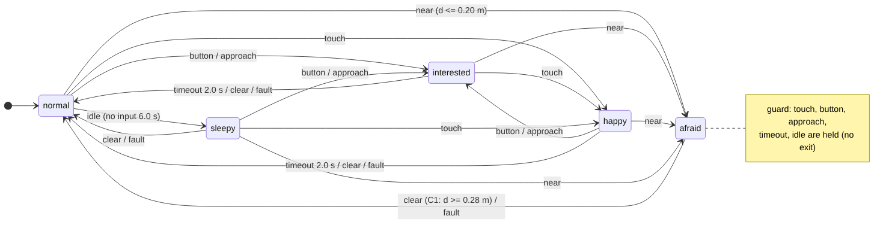

# ใบงาน Lab 06 — Student (กรอกแล้ว)

กลุ่ม: 4  
สมาชิก: ภูวเมศฐ์ กิตติธันยวัฒน์ (6752500126), _(เติมชื่อและรหัสสมาชิกคนอื่น)_  
วันที่ทดลอง: 12 พ.ย. 2026  
ขอบเขต: ทุก trial ด้านล่างเป็น synthetic software simulation ไม่ใช่การทดสอบ lamp/robot/human จริง

## 0. การตรวจเริ่มงาน

| การตรวจเริ่มงาน | บันทึก |
|---|---|
| Python version และผู้รับผิดชอบแต่ละหน้าที่ | Python 3.13 (ชุดหลักฐานรันซ้ำด้วย 3.13.18); policy/checker: ภูวเมศฐ์; รัน trial และอ่าน log: _(เติมชื่อ)_; รายงาน: _(เติมชื่อ)_ |
| วิธีหยุดและผู้ดูแลพื้นที่เคลื่อนไหว | แล็บนี้รันเฉพาะ offline simulator ไม่มีอุปกรณ์เคลื่อนที่จริง หยุดได้ด้วย Ctrl+C; ถ้าต่อหุ่นจริงต้องมีผู้ดูแลถือ emergency stop และกันพื้นที่ตามที่ผู้สอนกำหนด |
| หลักฐานว่าค่าสอบเทียบใช้ได้กับอุปกรณ์นี้ | **ไม่มี** — ไม่ได้สอบเทียบกับอุปกรณ์จริง ค่า pose/RGB เป็น proposed course model จึงห้ามนำไปขับ hardware โดยตรง |

**Prediction เมื่อ near กับ touch มาพร้อมกัน:** หุ่นควรเข้า afraid และไม่ตอบ touch เพราะ near มี priority สูงกว่า touch และ afraid เป็น safety state ที่ touch ออกไม่ได้ (ยืนยันในส่วนที่ 3: `touch_conflict` = `policy_held`)

## 1. Prediction และ FSM

Prediction จาก protocol (เขียนประกอบหลังได้ผลแล้ว ไม่ใช่ preregistration): C1 debounce/hysteresis น่าจะลดการสลับจาก bounce/noise เทียบ C0 โดยอาจหน่วง recognized time; `near` ควรเข้าสู่ afraid และ `fault` ต้องกลับ normal; touch ขณะ afraid ไม่ควรยกเลิก safety state.

Priority ที่ใช้กับ events ใน tick เดียวกัน: `fault > near > clear > touch > button > approach > timeout > idle`. `None` หมายถึงไม่มี transition/hold ปัจจุบัน ไม่ใช่ข้อมูลหาย.

| State \ Event | fault | near | clear | touch | button | approach | timeout | idle |
|---|---|---|---|---|---|---|---|---|
| normal | normal | afraid | normal | happy | interested | interested | None | sleepy |
| interested | normal | afraid | normal | happy | interested | interested | normal | None |
| happy | normal | afraid | normal | happy | interested | interested | normal | None |
| afraid | normal | afraid | normal | None | None | None | None | None |
| sleepy | normal | afraid | normal | happy | interested | interested | None | None |

ช่อง `None` = hold (อยู่ state เดิม)

| ข้อกำหนดออกแบบ | คำตอบของกลุ่ม |
|---|---|
| ลำดับ priority เมื่อหลาย event มาพร้อมกัน | fault > near > clear > touch > button > approach > timeout > idle (ใน scheduler tick เดียวกัน) |
| Entry และ exit ของ afraid | เข้าเมื่อ near (ระยะ ≤ 0.20 m) จากทุก state; ออกเมื่อ clear (C1: ระยะ ≥ 0.28 m, C0: > 0.20 m) หรือ fault → normal; event อื่นทั้งหมดถูก hold |
| Timeout ของ interested และ happy | 2.0 s (`active_timeout_s`) ไม่มี input → normal |
| Inactivity ที่ทำให้เข้าสู่ sleepy | 6.0 s ไม่มี input ขณะอยู่ normal (`sleep_after_s`); ใน run C1/r01 เกิด idle ที่ 15.0 s |
| Debounce และ hysteresis ป้องกันอะไร | debounce 0.06 s กัน button/touch เด้ง (bounce) นับซ้ำ; hysteresis near 0.20/0.28 m และ approach 0.80/0.95 m กันสถานะสลับไปมาเมื่อระยะแกว่งรอบเกณฑ์ (chattering). หลักฐาน: C0 ไม่มีทั้งสองอย่าง สลับ near/clear 29 ครั้งระหว่าง 7.0–9.0 s ใน r01 ส่วน C1 เข้า afraid ครั้งเดียว |

State diagram (ไม่แสดง self-loop/hold; ตรวจแล้วตรงกับตารางทุกช่อง):



ไฟล์ต้นฉบับแก้ได้: `evidence/diagram/fsm.mmd`

จาก normal สามารถไป interested/happy/afraid/sleepy ได้ด้วย button/touch/near/idle ตามลำดับ; timeout จาก interested/happy กลับ normal; clear/fault ออกจาก afraid. Fault/near/clear guard ใช้ก่อน afraid hold.

`check_submission.py --contract group`: 40/40 transitions ผ่าน. ไม่แก้ sensor/output safety logic.

## 1.5 การแสดง state และงบเวลา

Simulator ใช้ q = [tilt, extend, nod] หน่วย rad (joint bounds ±0.35, ±0.25, ±0.30 rad) และ slew สูงสุด 0.8 rad/s; ค่าจาก `interface_contract.json`

| State | Movement [tilt, extend, nod] (rad) และเหตุผล | RGB 0–255 | Entry หรือ recovery |
|---|---|---|---|
| normal | [0, 0, 0] ท่ากลาง พร้อมรับ input | (60, 90, 140) ฟ้าเทา | เริ่มต้น; กลับมาจาก timeout, clear, fault |
| interested | [0.22, 0.18, 0.06] เอียงและยืดเข้าหาคน เหมือนเงยหน้าสนใจ | (255, 180, 0) เหลืองส้ม | เข้าเมื่อ button/approach; กลับ normal เมื่อ timeout 2.0 s |
| happy | [0.10, 0.10, 0.18·sin(2π·t)] พยักหัวขึ้นลง 1 Hz เหมือนดีใจ | (40, 220, 80) เขียว | เข้าเมื่อ touch; กลับ normal เมื่อ timeout 2.0 s |
| afraid | [−0.22, −0.22, −0.16] เอนถอยและหดตัวหนีจากสิ่งที่อยู่ใกล้ | (230, 30, 30) แดง | เข้าเมื่อ near; ออกเมื่อ clear หรือ fault เท่านั้น |
| sleepy | [0, −0.15, −0.20] หดตัวและก้มหัวลง | (50, 40, 100) ม่วงเข้มหรี่ | เข้าเมื่อ idle 6.0 s; ตื่นเมื่อ button/approach/touch |

จุดเริ่มของการวัด = เวลาที่ผู้ใช้กด/สัมผัส/ข้ามเกณฑ์ระยะ (`source_time_s`) ไม่ใช่เวลาที่ controller รับ; จุดจบ = output จริงเปลี่ยนครั้งแรก (`first_motion_s`, `first_rgb_s`)

| ส่วนที่ใช้เวลา | งบ (s) | วิธีวัด |
|---|---:|---|
| Sensor และ transport | 0.12 | sample ทุก 0.02 s; ข้อมูลเก่ากว่า `stale_s` = 0.12 s ถือว่าใช้ไม่ได้ (`raw_*.csv`: `*_sample_s` เทียบ `time_s`) |
| Filter และ decision | 0.06 | debounce 0.06 s ใน C1 (`recognized_time_s − source_time_s` ใน `events_*.csv`) |
| Queue และ actuator หรือ RGB | 0.04 | scheduler delay 0.04 s (`applied_time_s − queued_time_s`) |
| รวมและส่วนเผื่อถึง 1 s | 0.22 + เผื่อ 0.78 | ค่าสูงสุดที่วัดได้จริงใน C1 = 0.14 s (`both_latency_s`) |

ถ้า output ไม่เปลี่ยนหรือยังไม่เกิดก่อนจบ trial: บันทึก latency เป็นค่าว่าง (CSV) / null (JSON) / N/A (รายงาน) พร้อม status และ reason เช่น `policy_held`, `no_state_change`, `censored_end` ไม่แทนด้วย 0 เพราะ 0 จะดูเหมือนตอบสนองทันทีและทำให้ค่าเฉลี่ยผิด

## 2. ผล paired synthetic trials

| Condition/seed | External inputs | Both onset | ≤1 s both | No both onset/status | Max observed latency (s) | State transitions |
|---|---:|---:|---:|---:|---:|---:|
| C0/41 | 10 | 7 | 7 | 3 | .24 | 67 |
| C1/41 | 10 | 7 | 7 | 3 | .14 | 9 |
| C0/42 | 10 | 6 | 6 | 4 | .18 | 72 |
| C1/42 | 10 | 7 | 7 | 3 | .14 | 10 |
| C0/43 | 10 | 6 | 6 | 4 | .04 | 63 |
| C1/43 | 10 | 7 | 7 | 3 | .14 | 9 |

ในชุด seed เหล่านี้ C1 มี transitions น้อยกว่าและ primary both-onset count 7/7 ทุก repeat. ตัวเลขเป็น paired synthetic replications จาก input CSV เดียวกันต่อ seed; 3 seeds ไม่ใช่ 3 independent physical trials. Missing/no onset ไม่ถูกแทนด้วย zero-latency.

## 3. ตัวอย่าง trace จาก C1/seed 41

| Input ID | Source (s) | Recognized (s) | Decision/queued (s) | Applied (s) | Motion/RGB onset (s) | Both latency (s) | Status |
|---|---:|---:|---:|---:|---:|---:|---|
| button_01 | 1.00 | 1.10 | 1.10 | 1.14 | 1.14 / 1.14 | .14 | responded |
| near_01 | 7.00 | 7.00 | 7.00 | 7.04 | 7.04 / 7.04 | .04 | responded; normal→afraid |
| touch_conflict | 7.00 | 7.06 | 7.06 | N/A | N/A | N/A | policy_held; afraid guard |
| invalid_01 | 11.00 | 11.00 | 11.00 | N/A | N/A | N/A | no_state_change; already normal |

`touch_conflict` ไม่ถูกทิ้งเงียบ ๆ: event log แสดง `policy_held` และ reason `no transition / afraid guard`. `invalid_01` มี fault event แต่ output neutral อยู่แล้ว จึง `no_state_change` และไม่สร้าง onset ใหม่. Status เหล่านี้ต่างจาก `preempted_before_apply` และ `censored_end`; N/A ไม่ใช่ latency=0.

### จุดตรวจจาก raw/event CSV (C1/seed 41; เทียบ C0 ในวงเล็บ)

| จุดตรวจ | ค่าที่อ่านจาก event CSV |
|---|---|
| near และ touch พร้อมกันที่ 7 s | C1: `e0005` near normal→afraid applied 7.04 s; `e0006` touch_conflict `policy_held` (afraid guard). (C0: touch `discarded_priority`; near แล้วสลับ near/clear ไปมา 29 ครั้งจน 8.98 s) |
| clear ที่ 9 s | C1: `e0007` clear_02 afraid→normal recognized 9.00, applied 9.04 s (both latency .04 s) |
| invalid ที่ 11 s และ stale ที่ 12 s | `e0008` invalid_01 และ `e0009` stale_01 เป็น fault → normal แต่อยู่ normal อยู่แล้ว จึง `no_state_change` ไม่มี onset ใหม่ |
| button ที่ 18 s หลัง inactivity | idle `e0010` ที่ 15.00 s normal→sleepy (applied 15.04); `e0011` button_02 recognized 18.06 sleepy→interested applied 18.10 s (both .10 s); timeout `e0012` 20.06 → normal |
| เหตุผลที่ state ไม่เปลี่ยนหนึ่งกรณี | touch_conflict ที่ 7.06 s: afraid hold ทุก event ยกเว้น fault/near/clear (`reason` = `no transition / afraid guard`) |

Timeline จาก run C1/seed 41 (`events_C1_r01.csv`):

| source (s) | event | state ก่อน | decision (s) | state หลัง |
|---:|---|---|---:|---|
| 1.00 | button | normal | 1.10 | interested |
| 3.00 | touch | interested | 3.06 | happy |
| 5.00 | approach | happy | 5.00 | interested |
| 6.40 | clear | interested | 6.40 | normal |
| 7.00 | near | normal | 7.00 | afraid |
| 7.00 | touch (conflict) | afraid | 7.06 | afraid (held) |
| 9.00 | clear | afraid | 9.00 | normal |
| 15.00 | idle (internal) | normal | 15.00 | sleepy |
| 18.00 | button | sleepy | 18.06 | interested |
| 20.06 | timeout (internal) | interested | 20.06 | normal |

Finding: C1 กัน chattering ได้ — C0/r01 มี near/clear สลับ 29 ครั้งในช่วง 7.0–9.0 s (`events_C0_r01.csv`, `status` = `preempted_before_apply`/`preempted_partial`) ขณะที่ C1 เข้า afraid ครั้งเดียวที่ 7.04 s และออกที่ 9.04 s

## 3.5 RGB และ response time

Expected input IDs ประกาศก่อนรันจาก contract: `button_01, touch_01, approach_01, clear_01, near_01, clear_02, button_02` (primary 7 ตัว)

Latency ราย input (s) — ค่า seed 41 / 42 / 43:

| Input / condition | motion | RGB | both | status |
|---|---|---|---|---|
| button / C0 | .04 / .04 / .04 | .04 / .04 / .04 | .04 / .04 / .04 | responded |
| button / C1 | .14 / .14 / .14 | .14 / .14 / .14 | .14 / .14 / .14 | responded |
| touch / C0 | .04 / .04 / .04 | .04 / .04 / .04 | .04 / .04 / .04 | responded |
| touch / C1 | .10 / .10 / .10 | .10 / .10 / .10 | .10 / .10 / .10 | responded |
| approach / C0 | .24 / .16 / .04 | .24 / .16 / .04 | .24 / .16 / .04 | responded |
| approach / C1 | .04 / .04 / .04 | .04 / .04 / .04 | .04 / .04 / .04 | responded |

| สรุปทุก repeat (3 seeds) | C0 raw | C1 guarded |
|---|---|---|
| ทุก source และจำนวน both ที่วัดได้ | 30 sources, both 19 | 30 sources, both 21 |
| Expected set ของกลุ่ม ผ่าน ≤ 1 s และ misses | 19/21 ผ่าน, miss 2 (clear_01 seed 42 `filtered_not_recognized`; clear_02 seed 43 `no_state_change`) | 21/21 ผ่าน, miss 0 |
| Motion missing และ RGB missing | 11 และ 11 | 9 และ 9 |
| No change / held / filtered / invalid | no_state_change 7, discarded_priority 2, filtered 1, preempted 1 | no_state_change 6, policy_held 3 |

1. **Command queued เวลาใด แล้ว output เปลี่ยนเวลาใด** — เช่น button_01 C1: decision/queued 1.10 s, applied และ motion/RGB onset 1.14 s ต่างกัน 0.04 s เท่ากับ scheduler delay ของ model; ไม่ใช่เวลาที่มอเตอร์จริงขยับ
2. **C1 ลดปัญหาใดจาก C0 และเสียเวลาเพิ่มเท่าไร** — ลด state transitions จาก 63–72 เหลือ 9–10 ต่อ run และ primary miss จาก 2 เหลือ 0 (จาก 21). แลกด้วย latency ของ button +0.10 s (.04 → .14) และ touch +0.06 s (.04 → .10) จาก debounce; แต่ approach ใน C1 เร็วและคงที่กว่า (.04 s ทุก seed เทียบ C0 .04–.24 s) เพราะ C0 สลับ approach ไปมาก่อนคงที่
3. **Simulator ให้หลักฐานอะไร และต้องเพิ่มอะไรก่อนรับรองอุปกรณ์จริง** — ให้หลักฐานเวลาในแบบจำลองถึง software output เท่านั้น; ต้องวัด onset จริงด้วยกล้องความเร็วสูง/photodiode สำหรับ RGB และ encoder สำหรับข้อต่อ พร้อม clock ที่ sync กับเวลากดปุ่มจริง และสอบเทียบ pose/RGB บนอุปกรณ์

## 4. การตีความและข้อจำกัด

C1 ลดจำนวน state transitions จาก 63–72 เป็น 9–10 ในสาม paired seeds และทั้งสอง condition มี both onset 6–7 จาก 10 sources. นี่เป็นผลของ policy/protocol ใน offline model; C1 รวม debounce/hysteresis จึงไม่แยกผลแต่ละส่วน. `both_latency_s` วัดถึง applied software pose/RGB output ไม่ใช่การเคลื่อนที่หรือแสงจริง. การยืนยัน hardware ต้องใช้ external camera/photodiode/encoder และ clock ที่สอบเทียบ.

ไฟล์หลักฐานใน `lab_06/evidence/` (อยู่ใน repo):

| รายการตรวจงานส่ง | ไฟล์ | ครบ |
|---|---|---|
| student_policy.py และตาราง 5 states × 8 events | `student_policy.py`, ส่วนที่ 1 | ☑ |
| Diagram และ mapping 3 inputs กับ movements | `evidence/diagram/fsm.png`, ส่วนที่ 1.5 | ☑ |
| Raw CSV, event CSV, config, metrics, manifest ทุก condition | `evidence/group4_run/raw_C*_r0*.csv`, `events_C*_r0*.csv`, `config.json`, `metrics.json`, `manifest.json`, `source_snapshot/` | ☑ |
| คำสั่งรัน Python version seed repeats output directory | คำสั่งข้างล่าง, seeds 41–43, repeats 3 | ☑ |
| Latency motion/RGB/both แยก source กับ command พร้อม misses | ส่วนที่ 3.5 | ☑ |
| Finding ข้อจำกัด และแผนสอบเทียบ | ส่วนที่ 3, 4 และ 5 | ☑ |

ผล checker: `evidence/checker_group.txt` (40/40)

```powershell
py -3 check_submission.py --contract group
py -3 lab06.py --policy student --condition all --repeats 3 --output-dir evidence\group4_run
```

Debounce, thresholds, states, poses, scheduler และ bounds เป็น proposed course model; ไม่มี learning, ROS transport, linkage, torque, collision model หรือ human-subject data. ไม่ควรนำ mapping นี้ไปขับฮาร์ดแวร์โดยตรง.


## 5. Exit quiz

1. **State machine ช่วยตรวจความขัดแย้งของ if–else ได้อย่างไร** — ตาราง state × event บังคับให้ต้องกำหนดผลทุกช่อง (40 ช่อง) จึงเห็นได้ทันทีว่ากรณีใดยังไม่ได้ตัดสินหรือมีสองกฎชนกัน ต่างจาก if–else ซ้อนกันที่ลำดับเงื่อนไขซ่อนการชนไว้; checker ตรวจได้ครบทุกคู่
2. **ทำไม afraid ต้องมีทั้ง entry, exit และ priority เมื่อ near กับ touch พร้อมกัน** — entry บอกว่าเข้าเมื่อใด exit กันไม่ให้ค้างตลอดไป (ออกได้เมื่อ clear/fault) และ priority ตัดสินว่า event ใดชนะใน tick เดียวกัน; ถ้าไม่มี priority touch อาจทำให้หุ่น "ดีใจ" ขณะมีสิ่งอยู่ใกล้เกินไป ซึ่งไม่ปลอดภัย
3. **ตัวอย่างส่วนที่ต้องเปลี่ยนจากประสบการณ์จึงจะเรียกว่า learning** — ถ้าเกณฑ์ near/approach หรือ timeout ปรับเองตามประวัติการเล่นของผู้ใช้ (เช่น คนที่เข้าใกล้บ่อยโดยไม่เกิดอันตราย ทำให้เกณฑ์ afraid ลดลงช้า ๆ) จะเป็น learning; ในแล็บนี้ทุกกฎและค่าคงที่ ไม่มีส่วนใดเปลี่ยนจากประสบการณ์ จึงเป็นการปรับพฤติกรรมตามกฎ (`learning: none` ใน contract)
