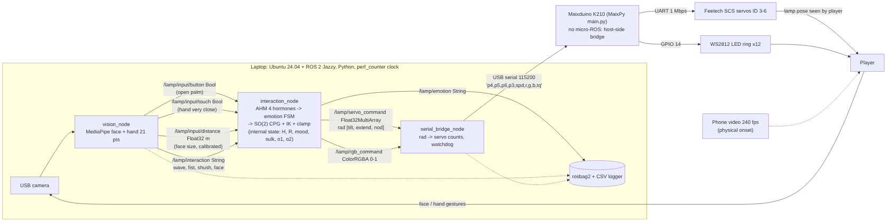

# Mini Project Proposal — กลุ่ม 4

**ชื่อโครงงาน:** โคมไฟหุ่นยนต์ที่มีอารมณ์ด้วยฮอร์โมนเทียมและ SO(2) CPG  
**สมาชิก:** ภูวเมศฐ์ กิตติธันยวัฒน์ (6752500126), _(เติมชื่อและรหัสสมาชิกคนอื่น)_  
**สถานะ:** มีโคมไฟ 4 แกนและโค้ดที่ทำงานได้แล้ว (`กลุ่ม4.py` / `auto_bio_lamp.py`); การทดลอง C0/C1 ทั้ง simulation และหุ่นจริงยังไม่ได้ทำ ข้อมูลในเอกสารนี้เป็นแผน ข้อมูลที่เป็นผลจริงมีเฉพาะ offline bridge study ของ Lab 07

## 1. แรงบันดาลใจทางชีววิทยาและ sensor

สัตว์ไม่ได้ตอบสนองต่อสิ่งเร้าแบบเปิด-ปิดทันที ฮอร์โมนทำให้ "อารมณ์" สะสมและคงอยู่ระยะหนึ่งหลังสิ่งเร้าหาย (endocrine system) ส่วนการเคลื่อนไหวเป็นจังหวะมาจากวงจรประสาทสร้างจังหวะ (CPG) เราจึงยืมหลักการ 2 อย่างนี้มาใช้กับโคมไฟ:

- **Artificial Hormone Mechanism (AHM)** — กรอบจาก Homchanthanakul et al. (2019), IROS, DOI 10.1109/IROS40897.2019.8968580 และ Week 04
- **SO(2) CPG ของ Dr. Poramate Manoonpong** — lec5 สไลด์ 18 / Week 03
- **Embodiment** — โคมไฟสื่ออารมณ์ด้วยท่าทางและสีไฟ (Week 01)

Sensor ที่วัดได้: กล้อง USB + MediaPipe ให้กรอบหน้า (ตำแหน่ง ขนาด) และ landmark มือ 21 จุด แปลงเป็นท่า แบมือ / กำปั้น / โบกมือ / ชู่ว์ ที่ 20 Hz

## 2. ระบบและสมการ

**AHM (4 ชนิด):** H_new = clamp(H + dt·(k_prod·max(S,0) − k_clear·H − k_bind·R), 0, 1), R = H, dt = 0.05 s

| ฮอร์โมน | k_prod | k_clear | k_bind | สิ่งเร้า S |
|---|---:|---:|---:|---|
| Happy | 0.35 | 0.20 | 0.05 | เห็นหน้า 1.0, แบมือ 1.4, โบกมือ 1.8 |
| Angry | 0.60 | 0.30 (×4 เมื่อ S < 0) | 0.05 | กำปั้น +1, แบมือ/ชู่ว์ −1 |
| Startle | 6.5 | 1.5 | 0.2 | หน้า/มือพุ่งเข้าเร็ว +1 |
| Rest | 0.14 | 0.08 (×2.5 เมื่อ S < 0) | 0 | ไม่มีใคร +1, มีคน −1 |

สมการ source: Hc(t) = βHc(t−1) + Hg(t) − Hr(t); รูป Euler และค่า k เป็น group model

**SO(2) CPG:** a(t+1) = α[[cos φ, sin φ], [−sin φ, cos φ]]·tanh(a(t)), α = 1.10, a(0) = [0.1, 0], อัปเดตสองนิวรอนพร้อมกัน

**Integration (AHM–emotion + AHM–CPG):**
- R ของฮอร์โมน → emotion FSM แบบ hysteresis (เช่น HAPPY เข้า 0.75 / ออก 0.55, ANGRY เข้า 0.55 / ออก 0.32) → ท่าและสี LED
- R เดียวกัน → φ = clamp(0.20 + 0.20·R_Happy + 0.25·R_Angry − 0.10·R_Rest + …, 0.10, 0.50) → CPG แกว่งเร็วเมื่อดีใจ/โกรธ ช้าเมื่อเหงา
- มุมข้อต่อ q = q_mid(state) + A(state)·o → IK + clamp ANGLE_LIM → serial → Maixduino → เซอร์โว 4 ตัว + LED 12 ดวง

## 3. คำถามวิจัยและสมมติฐาน

**คำถาม:** การใช้ AHM คั่นระหว่างสิ่งเร้ากับ emotion/CPG ลดการสลับอารมณ์และการกระตุกของคำสั่งมอเตอร์เทียบกับ direct mapping หรือไม่ โดยยังตอบท่ามือภายใน 1 s

**สมมติฐาน:** ถ้าใช้ AHM (C1) แทน direct mapping (C0) แล้ว state switches/นาที และ joint command total variation จะลดลง ≥ 50% เพราะ H สะสม-สลายตามเวลาจึงกรอง detection ที่กระพริบไม่กี่เฟรม แต่ latency ของ HAPPY จะเพิ่มขึ้น

| Condition | สิ่งที่ต่าง | สิ่งที่คงที่ | Repeats |
|---|---|---|---:|
| C0 baseline | R = clamp(S, 0, 1) ทันที ไม่มี memory | กล้อง, MediaPipe, เกณฑ์ FSM, CPG, IK, bounds, ความเร็ว, สคริปต์ท่า | 3 sim + 3 real |
| C1 | AHM 4 ฮอร์โมน | เหมือน C0 | 3 sim + 3 real |

| Metric | หน่วย | วัดอย่างไร | Missing |
|---|---|---|---|
| state_switch_rate_per_min | ครั้ง/นาที | จำนวนการเปลี่ยน state ÷ นาที | log ขาด > 2 s = N/A |
| gesture_to_state_latency_s | s | เฟรมแรกที่เห็นท่า → state ที่คาด | ไม่เปลี่ยนใน 5 s = miss นับแยก |
| joint_command_total_variation | rad/นาที | Σ\|Δq\| ของ 4 ข้อต่อ ÷ นาที | serial error นับเป็น fault แยก |

## 4. Protocol

**Simulation:** บันทึก input trace (สิ่งเร้า/ท่ามือต่อเฟรม พร้อม timestamp) 3 ชุดจากผู้เล่นทำสคริปต์ 600 s แล้วรัน controller แบบ offline (ปิด serial) ด้วย C0 และ C1 บน trace เดียวกัน (paired)

**Real robot:** C0 และ C1 อย่างละ 3 trials × 600 s สลับลำดับ C0→C1 / C1→C0 / C0→C1 ผู้เล่นคนเดิมต่อคู่ พัก 5 นาทีระหว่าง trial

**Scenario 600 s:**

| เวลา | งานของผู้เล่น | สิ่งที่วัด |
|---|---|---|
| 0:00–2:00 | ยืนหน้ากล้อง หันซ้าย-ขวา | CURIOUS → HAPPY, การหันตาม |
| 2:00–4:00 | แบมือ แล้วโบกมือ | HAPPY + ท่าดีใจ, latency |
| 4:00–6:00 | กำปั้น 10 s, แบมือ, ชู่ว์ | ANGRY, หายโกรธ, QUIET |
| 6:00–8:00 | ออกจากกล้อง 90 s แล้วกลับมา | SAD → SLEEPY, การตื่น |
| 8:00–10:00 | โบกมือ, กำปั้น, ชู่ว์ ซ้ำ | latency ซ้ำ |

Expected input IDs ประกาศก่อนรัน: face_01, palm_01, wave_01, fist_01, palm_02, shush_01, leave_01, return_01, wave_02, fist_02, shush_02

**Controls:** โค้ด commit เดียวกัน (บันทึก SHA-256), กล้องตำแหน่ง/มุมเดิม, แสงเดิม, ระยะผู้เล่น 0.5–1.0 m, เริ่มที่ STARTUP_Q และฮอร์โมน = 0, deadband/slew/ANGLE_LIM ไม่เปลี่ยน

**Clock:** software latency ใช้ `perf_counter` ของ laptop เครื่องเดียว; physical onset ใช้วิดีโอ 240 fps ซิงก์ด้วย LED marker (±4.2 ms + ±50 ms ของ control tick); ไม่มีวิดีโอ = N/A

## 5. Safety และ calibration

- ผู้ดูแล 1 คนอยู่ที่ปลั๊กไฟเซอร์โวตลอด (ตัดไฟ = emergency stop) และกด q เพื่อเข้าท่าพัก
- ยึดฐานกับโต๊ะ ผู้เล่นห่าง ≥ 0.5 m นอกระยะเอื้อมของแขน (≈ 0.23 m)
- หยุดเมื่อ: ชน/สั่นผิดปกติ, เซอร์โวร้อน, กล้องหลุด > 3 s (โค้ดเข้าท่าพักเอง), serial error, คำสั่งหลุด ANGLE_LIM หรือผู้เล่นขอหยุด
- ก่อนเริ่มทุก session: สอบเทียบ ZERO และทิศเซอร์โว ตรวจ ANGLE_LIM ด้วยมือ ตรวจ `is_safe()` และทดสอบ shutdown_sequence
- ผู้เล่นเป็นสมาชิกที่ยินยอม ถอนตัวได้ทุกเวลา ไม่เก็บภาพใบหน้าเป็นไฟล์ถาวร และทำหลังผู้สอนอนุมัติ

## 6. Timeline และหลักฐานที่จะส่ง

| สัปดาห์ | งาน | ผู้รับผิดชอบ |
|---|---|---|
| 1 | ส่ง proposal; เพิ่ม CSV logger และสวิตช์ C0/C1 ในโค้ด | _(เติมชื่อ)_ |
| 2 | บันทึก trace 3 ชุด; รัน simulation 6 trials และวิเคราะห์ | _(เติมชื่อ)_ |
| 3 | สอบเทียบหุ่นจริง ทดสอบ safety; รัน 6 trials × 600 s พร้อมวิดีโอ | _(เติมชื่อ)_ |
| 4 | วิเคราะห์ raw data, missing, uncertainty; เขียนรายงานและสไลด์ | _(เติมชื่อ)_ |

หลักฐานที่จะส่ง: log CSV ต่อ tick, `config.json` + SHA-256, rosbag, วิดีโอ 240 fps, ตาราง metric พร้อม N/A และกราฟ H/state/φ/q ต่อ trial

**ความเสี่ยง:** MediaPipe พลาดในแสงน้อย; ฮอร์โมนชน clamp 1.0; เซอร์โวร้อนเมื่อรัน 10 นาที; ต้องเพิ่ม logger และสวิตช์ C0/C1 ก่อนเริ่ม
