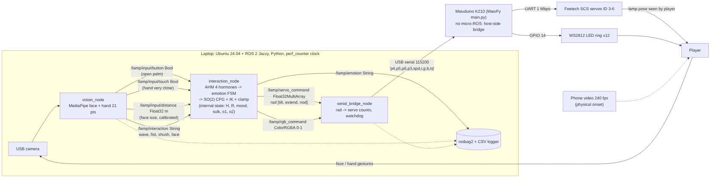

# ใบงาน Lab 07 — ROS 2 graph, experimental design และ Mini Project proposal (กรอกแล้ว)

กลุ่ม: 4  
สมาชิก: ภูวเมศฐ์ กิตติธันยวัฒน์ 6752500126
วันที่: 12 พ.ย. 2026  
Policy: group transition policy ที่ผ่าน checker (`evidence/checker_group.txt`, 40/40)  
Mini Project: โคมไฟหุ่นยนต์ 4 แกนที่มีฮอร์โมนเทียม 4 ตัว + emotion FSM + SO(2) CPG (โค้ด `auto_bio_lamp.py` ใน branch นี้: `กลุ่ม4.py`) — proposal ฉบับเต็มอยู่ที่ [`PROPOSAL.md`](PROPOSAL.md) และ [`proposal.json`](proposal.json)  
ขอบเขต: รัน offline simulation ของแล็บแล้ว; ROS 2 บนหุ่นจริงและ human scenario 600 s **ยังไม่ได้ทดลอง** (เป็นแผน)

> หมายเหตุการแก้ไข: `proposal.json` ฉบับก่อนเขียนเป็นงานวิจัยเรื่อง transport jitter/drop ของ offline model และ integration เป็น gait หกขา ซึ่งไม่ใช่ Mini Project ของกลุ่ม ฉบับนี้เขียนใหม่เป็นโคมไฟของกลุ่ม; ฉบับเดิมเก็บไว้ที่ `evidence/proposal_offline_transport_study_old.json`

## 1. ROS 2 graph ของกลุ่ม



ไฟล์ต้นฉบับแก้ได้: `evidence/diagram/ros2_graph.mmd`. ขอบเขต: host = laptop (Ubuntu 24.04 + ROS 2 Jazzy) รัน vision, interaction, serial bridge และ logger; MCU = Maixduino K210 ขับเซอร์โวและ LED

- **Node ที่เก็บ internal state และผู้รับผิดชอบ:** `interaction_node` เก็บ H/R ของฮอร์โมน 4 ตัว, emotion state, mood, หลอดงอน และ CPG o1/o2 (_ผู้รับผิดชอบ: ภูวเมศฐ์); `serial_bridge_node` เก็บคำสั่งล่าสุดและ watchdog (ภูวเมศฐ์)
- **เหตุใด graph นี้มีทั้ง AHM และ SO(2) CPG แม้เลือก AHM–emotion:** AHM ตัดสินว่า "รู้สึกอะไร" (เลือก state) ส่วน CPG สร้าง "จังหวะการขยับ" ของ state นั้น และค่า R ของฮอร์โมนก็ปรับ φ ของ CPG ด้วย (AHM–CPG) จึงต้องมีทั้งสองตัวใน `interaction_node`

## 2. Topic contract และ QoS

| Topic | Type | หน่วยหรือความหมาย | Publisher → subscriber |
|---|---|---|---|
| `/lamp/input/button` | std_msgs/Bool | true = เห็นท่าแบมือ (OPEN_PALM) | vision_node → interaction_node, logger |
| `/lamp/input/touch` | std_msgs/Bool | true = มือเข้าใกล้มาก (พื้นที่มือ > 15% ของภาพ) ใช้แทน touch เพราะโคมไม่มี touch sensor | vision_node → interaction_node, logger |
| `/lamp/input/distance` | std_msgs/Float32 | m ประมาณจากความสูงกรอบหน้า (ต้องสอบเทียบกับตลับเมตร) | vision_node → interaction_node, logger |
| `/lamp/interaction` | std_msgs/String | event: `face`, `wave`, `fist`, `shush`, `open_palm`, `spike`, `none`, `invalid` | vision_node → interaction_node, logger |
| `/lamp/emotion` | std_msgs/String | state: EXPLORING, CURIOUS, HAPPY, ANGRY, STARTLED, SAD, NORMAL, SLEEPY, SULK, QUIET | interaction_node → logger |
| `/lamp/servo_command` | std_msgs/Float32MultiArray | rad [tilt, extend, nod] = [ฐาน q1, การยืดไหล่+ศอกผ่าน IK, ข้อมือ q4] | interaction_node → serial_bridge_node, logger |
| `/lamp/rgb_command` | std_msgs/ColorRGBA | r, g, b = ค่า 0–255 / 255, a = 1 | interaction_node → serial_bridge_node, logger |

| กลุ่ม topic | Reliability และ depth | Durability และ stale rule |
|---|---|---|
| Sensor inputs | RELIABLE, KEEP_LAST depth 10 | VOLATILE; ข้อมูลที่รับมาเก่ากว่า 0.12 s (receipt) = fault → S = 0 และไม่สะสมฮอร์โมน |
| Interaction และ emotion | RELIABLE, KEEP_LAST depth 10 | VOLATILE; ไม่มี interaction ใหม่เกิน 3 s = กล้องหลุด → เข้าท่าพัก |
| Servo และ RGB command | RELIABLE, KEEP_LAST depth 10 | VOLATILE; ไม่มีคำสั่งใหม่เกิน 0.5 s → bridge คงท่าเดิม; เกิน 3 s → ส่ง SHUTDOWN_Q แล้วหยุด |

ทุก topic ใช้ QoS เดียวกับ interface ของรายวิชาเพื่อให้ publisher/subscriber เข้ากันได้; ถ้าไม่เห็น message ให้ตรวจ type และ QoS ด้วย `ros2 topic info -v`

- **คำศัพท์ event และ state:** ตามตารางข้างบน; `invalid` = MediaPipe ไม่คืนผล/ภาพเสีย → fault; recovery = กลับ EXPLORING เมื่อได้ภาพปกติ
- **Callback rate, queue, stale และ watchdog:** vision 20 Hz (จำกัดโดย MediaPipe ~30 fps), interaction tick 20 Hz (dt 0.05 s ตรงกับสมการฮอร์โมน), serial bridge 20 Hz, queue depth 10 = 0.5 s ของข้อมูล, stale 0.12 s, watchdog 3 s

## 3. MCU, clock และการวัดเวลา

| องค์ประกอบ | แผนของกลุ่ม |
|---|---|
| MCU board firmware และ sensor | Maixduino K210 รัน MaixPy `main.py`: อ่านบรรทัด serial 9 ค่า แล้วสั่งเซอร์โว Feetech SCS ID 3–6 (UART 1 Mbps) และ LED WS2812 12 ดวง; sensor (กล้อง) อยู่ฝั่ง laptop |
| Transport และการเชื่อมต่อ Agent | USB serial 115200 จาก `serial_bridge_node`; **ไม่ใช้ micro-ROS** เพราะ K210/MaixPy ไม่รองรับ micro-ROS client จึงแปลงเป็น ROS ที่ host แทน Agent; เปิดพอร์ตแบบ DTR/RTS = False กันบอร์ดเข้า bootloader |
| Host nodes และ logger | vision_node, interaction_node, serial_bridge_node และ `ros2 bag record` ทุก /lamp topics + CSV log ต่อ tick |
| Reconnect stale และ stop behavior | serial หลุด → bridge ลองเปิดใหม่ทุก 1 s และบันทึก fault; คำสั่งเก่ากว่า 0.5 s → คงท่าเดิม; เกิน 3 s หรือปิดโปรแกรม → SHUTDOWN_Q แล้วไฟดับ |

| จุดเวลา | Clock และวิธีจับคู่ source_id |
|---|---|
| Input ต้นทาง (ท่ามือ) | วิดีโอภายนอก 240 fps (เฟรมที่ท่าเริ่ม) และ `perf_counter` ของเฟรมกล้องที่ MediaPipe จับท่าได้ครั้งแรก; source_id ตามลำดับสคริปต์ (เช่น wave_01) |
| Controller receive และ decision | `perf_counter` ของ laptop ใน interaction_node เมื่อ state_mode เปลี่ยน; บันทึก source_id ที่ trigger |
| Command applied ใน simulator หรือ driver | `perf_counter` ตอน serial_bridge เขียนบรรทัดคำสั่ง (ก่อน flush) |
| Physical motion และ RGB onset | วิดีโอ 240 fps เฟรมแรกที่แขนขยับ/ไฟเปลี่ยนสี; ซิงก์กับ laptop ด้วย LED marker กระพริบตอนเริ่ม trial |

- **Metric latency ของกลุ่มเริ่มที่** เฟรมแรกที่กล้องเห็นท่ามือ (software) / เฟรมวิดีโอที่ท่าเริ่ม (physical) **จบที่** state_mode เปลี่ยน (software) / เฟรมแรกที่แขนหรือไฟเปลี่ยน (physical)
- **Clock conversion และ uncertainty:** software ใช้ clock เดียวกันทั้งหมดบน laptop ไม่ต้องแปลง; physical แปลงด้วย marker วิดีโอ ความไม่แน่นอน ±4.2 ms (1 เฟรม) + ±50 ms (control tick); Maixduino ไม่มี timestamp ส่งกลับ
- **ก่อน real robot:** สอบเทียบ ZERO และทิศของเซอร์โวแต่ละตัว ตรวจ ANGLE_LIM ทุกข้อต่อด้วยมือ ตรวจ `is_safe()` ทุกท่า และทดสอบ stop (ตัดไฟ + shutdown_sequence) ก่อนทุก session

## 4. คำถามวิจัยและสมการที่เชื่อมระบบ (Mini Project)

**Research question:** การใช้ AHM คั่นระหว่างสิ่งเร้าจากกล้องกับ emotion FSM และ SO(2) CPG ลดการสลับอารมณ์และการกระตุกของคำสั่งมอเตอร์ เมื่อเทียบกับ direct mapping หรือไม่ โดยยังตอบท่ามือภายใน 1 s

**Hypothesis:** ถ้า **ใช้ AHM (C1) แทน direct mapping (C0)** แล้ว **state switches ต่อนาทีและ joint command total variation จะลดลง ≥ 50%** เพราะ **H สะสม-สลายตามเวลา จึงกรอง detection ที่กระพริบไม่กี่เฟรม** แต่ latency ของ HAPPY จะเพิ่มขึ้น

| ตัวแปร | นิยามและค่าที่กลุ่มกำหนด |
|---|---|
| Independent variable | ชั้นสถานะภายใน: C0 direct (R = clamp(S,0,1)) เทียบ C1 AHM 4 ฮอร์โมน |
| Dependent variables | M1 state_switch_rate_per_min (ครั้ง/นาที), M2 gesture_to_state_latency_s (s), M3 joint_command_total_variation (rad/นาที) |
| Control variables และ initialization | โค้ด commit เดียวกัน, กล้องตำแหน่ง/มุมเดิม, แสงเดิม, ระยะผู้เล่น 0.5–1.0 m, เริ่มที่ STARTUP_Q และฮอร์โมน = 0, สคริปต์ท่าเดียวกัน |
| Baseline และเหตุผลที่ยุติธรรม | C0 ใช้ทุกส่วนเหมือน C1 ยกเว้นตัด dynamics ของฮอร์โมน จึงวัดผลของ AHM ได้ตรง ๆ |

| ส่วน | สมการหรือแหล่งอ้างอิง | พารามิเตอร์ หน่วย และที่มา |
|---|---|---|
| AHM (4 ชนิด) | source: Hc(t) = βHc(t−1) + Hg(t) − Hr(t) (Homchanthanakul 2019); ใช้: H += dt(k_prod·S − k_clear·H − k_bind·R), clamp 0–1 | dt 0.05 s; Happy 0.35/0.20/0.05, Angry 0.60/0.30/0.05 (fast ×4), Startle 6.5/1.5/0.2, Rest 0.14/0.08/0 (fast ×2.5) 1/s — group model |
| Dr. Poramate SO(2) CPG | a(t+1) = α[[cos φ, sin φ],[−sin φ, cos φ]]·tanh(a(t)) (lec5 สไลด์ 18); อัปเดตพร้อมกัน, a(0) = [0.1, 0] | α = 1.10 (Week 03), φ 0.10–0.50 rad |
| AHM–emotion และ AHM–CPG | emotion: FSM hysteresis บน R (HAPPY 0.75/0.55, ANGRY 0.55/0.32 …); CPG: φ = clamp(0.20 + 0.20·R_Happy + 0.25·R_Angry − 0.10·R_Rest + …, 0.10, 0.50); q = q_mid(state) + A(state)·o | เกณฑ์ normalized H, φ rad, q องศา — group model |

| Condition | สิ่งที่ต่างจาก baseline | สิ่งที่คงที่ |
|---|---|---|
| C0 baseline | R = clamp(S, 0, 1) ทันที ไม่มี memory | กล้อง, MediaPipe, เกณฑ์ FSM, CPG, IK, bounds, slew, ความเร็ว, สคริปต์ท่า |
| C1 treatment | AHM 4 ฮอร์โมนตามสมการ | เหมือน C0 ทุกอย่าง |

## 5. Protocol, metrics และ repeated tests

Expected input IDs ประกาศก่อนรัน: `face_01, palm_01, wave_01, fist_01, palm_02, shush_01, leave_01, return_01, wave_02, fist_02, shush_02`; primary latency subset = wave/fist/shush ทั้ง 6 ตัว

| Metric | สูตรหรือจุดเริ่มจบ | หน่วยและทิศทางที่คาด | Missing และ denominator |
|---|---|---|---|
| M1 state_switch_rate_per_min | จำนวนการเปลี่ยน state_mode ÷ นาทีของ trial | ครั้ง/นาที; C1 < C0 | log ขาด > 2 s = N/A; denominator = นาทีที่มี log จริง |
| M2 gesture_to_state_latency_s | เฟรมแรกที่เห็นท่า → state ที่คาดครั้งแรก | s; C1 > C0 (ช้ากว่า) แต่ ≤ 1 s สำหรับ fist/shush | ไม่เปลี่ยนใน 5 s = miss (N/A) นับแยก; denominator = 6 primary IDs |
| M3 joint_command_total_variation | Σ\|q[k] − q[k−1]\| ของ 4 ข้อต่อ ÷ นาที | rad/นาที; C1 < C0 | serial error นับเป็น fault แยก; คำสั่งที่ไม่ได้ส่ง (deadband) ไม่นับ |

Scenario เล่นกับคน 10 นาที (600 s):

| ช่วงนาที | Input task ของผู้เล่น | ผลที่บันทึกและข้อกำหนดหยุด |
|---|---|---|
| 0:00–2:00 | ยืนหน้ากล้อง หันซ้าย-ขวาช้า ๆ (face_01) | CURIOUS → HAPPY, การหันตาม; หยุดถ้าแขนเอื้อมเกินพื้นที่ |
| 2:00–4:00 | แบมือ (palm_01) แล้วโบกมือ (wave_01) | HAPPY + ท่าดีใจ, latency M2 |
| 4:00–6:00 | กำปั้น 10 s (fist_01) แล้วแบมือ (palm_02); ชู่ว์ (shush_01) | ANGRY, หายโกรธ, QUIET; หยุดถ้าแขนสั่นแรง |
| 6:00–8:00 | เดินออกจากกล้อง (leave_01) 90 s แล้วกลับมา (return_01) | SAD → NORMAL → SLEEPY และการตื่น |
| 8:00–10:00 | โบกมือ (wave_02), กำปั้น (fist_02), ชู่ว์ (shush_02) ตามสคริปต์ | ทำซ้ำ M2; จบด้วย shutdown_sequence |

Reset ทุก trial: ปิดและเปิดโปรแกรมใหม่ (ฮอร์โมน = 0, STARTUP_Q), รอ 10 s ก่อนเริ่ม; trial ที่ใช้ไม่ได้ (กล้องหลุด > 3 s, serial error) ยังเก็บ log และรายงานพร้อมเหตุผล

| Platform และ condition | Repeats ขั้นต่ำ | ลำดับ trial และคู่ input |
|---|---:|---|
| Simulation C0 | 3 | trace_01–03 (บันทึกจากผู้เล่นทำสคริปต์ 600 s) |
| Simulation C1 | 3 | trace_01–03 ชุดเดียวกับ C0 (paired) |
| Real robot C0 | 3 | คู่ 1: C0→C1, คู่ 2: C1→C0, คู่ 3: C0→C1 |
| Real robot C1 | 3 | ผู้เล่นคนเดิมในแต่ละคู่ สคริปต์เดียวกัน |

รวม 12 trials, real robot 6 × 10 นาที = 60 นาที + พัก 5 นาทีระหว่าง trial

- **File naming:** `<platform>_<condition>_r<NN>_<YYYYMMDD-HHMM>` เช่น `real_C1_r02_20261126-1430/` มี `log.csv`, `config.json` (SHA-256 ของโค้ด), `bag/`, `video.mp4`; simulation อ้าง `trace_NN` และ commit hash
- **หลักฐานตรวจความเหมือนของ C0/C1 และ sim/real:** เปรียบเทียบ `config.json` ทุกคู่ให้ต่างเฉพาะ field `condition`; ตรวจว่า input trace ของ simulation คู่เดียวกันมี hash ตรงกัน; บนหุ่นจริงตรวจลำดับ source_id ในวิดีโอว่าตรงสคริปต์

## A. Offline bridge study ของแล็บ (ผลที่รันแล้ว)

### B1. Hypothesis และ protocol ของ offline bridge study

Research question ของแบบฝึก offline (ไม่ใช่คำถาม Mini Project): combined modeled delay/jitter/drop เปลี่ยน transport age, software both-onset latency และ missing-source count อย่างไรเมื่อเทียบ ideal transport.

Prediction จาก protocol (เขียนประกอบหลังได้ผลแล้ว ไม่ใช่ preregistration): C1 น่าจะเพิ่ม transport age/drop/missing และอาจเพิ่ม latency; C0 ควรไม่มี modeled transport delay. C1 รวม jitter และ drop จึงไม่สามารถแยก causal effect ของแต่ละอย่าง.

Expected sources ประกาศไว้ก่อนการวิเคราะห์: `button_01, touch_01, approach_01, clear_01, near_01, clear_02, button_02, touch_conflict, fault_invalid, fault_stale`; primary positive subset 7 IDs แรก ยกเว้น conflict/fault ตาม contract. ทั้ง 10 sources ยังอยู่ใน source outcomes. ใช้ paired seeds 41–43, 22 s virtual duration, dt=.02 s, scheduler=.04 s, policy/bounds เดียวกัน.

### B2. ผล 3 paired offline repeats (`evidence/offline_run/summary.json`)

| Pair/seed | C0 median both latency (s) | C1 median (s) | C0/C1 mean transport age (s) | C1 received / 3303 published | C1 transport dropped | C0/C1 primary pass ≤1 s | C0/C1 primary missing |
|---|---:|---:|---:|---:|---:|---:|---:|
| 41 | .04 | .15 | .0000 / .0769 | 3031 | 257 | 7/7, 6/7 | 0, 1 |
| 42 | .06 | .14 | .0000 / .0779 | 3007 | 287 | 7/7, 6/7 | 0, 1 |
| 43 | .04 | .10 | .0000 / .0765 | 2991 | 300 | 7/7, 7/7 | 0, 0 |

เพิ่มเติม: C0 primary max both latency=.14,.14,.14 s; C1=.20,.22,.18 s. Fault ticks C0=20 ทุก seed; C1=54,81,56. State transitions C0=9,10,9; C1=17,36,17. สัญญาณที่ได้รับแต่ out-of-order และ censored มี counters แยกใน `summary.json`; ห้ามเอา published−received ทั้งหมดไปเรียกว่า transport drop.

ผลสนับสนุนว่า C1 combined stress มี mean transport age ราว .077 s และมี 0–1 primary missing ต่อ repeat เทียบ C0 ที่ไม่มี transport age และไม่มี primary missing. ทั้งนี้ C1 มี random jitter และ drop พร้อมกัน; ไม่สามารถระบุว่าปัจจัยใดทำให้ผลเปลี่ยน. Latency เป็น virtual software output onset ไม่ใช่การตอบสนองทางกายภาพ.

### B3. Missingness และ clocks

Baseline invalid/stale probes ถูกนับเป็น fault ticks; C1 transport stress ไม่ใช่การจำลอง reliable DDS guarantee. ต้องแยก stale acquisition จากเวลา receipt; ROS adapter ที่ไม่มี timestamp ตรวจได้เพียง receipt freshness. Delay+jitter+drop ใน C1 เป็น composite stress และไม่ตอบคำถามแยกผลแต่ละส่วน.

Offline trace มี fixture source identity/time; ROS messages จริงไม่มี Header. ห้ามจับคู่ข้าม node ด้วย ordinal หรือ payload ซ้ำโดยเดา. ต้องเพิ่ม source ID/clock correlation method/error bound และวัด physical servo/RGB onset ด้วย encoder/camera/photodiode ที่สอบเทียบ. หากไม่มี mapping ให้ source-to-physical latency เป็น N/A.

สถานะจริง ณ รายงานนี้: **ยังไม่ได้ทำ human scenario 600 s และยังไม่ได้ทดลอง robot/ROS**; ไม่มีการสร้างหรือประมาณผลจริงขึ้นมาแทนข้อมูล. ก่อนเริ่มต้องได้รับอนุมัติ/ผู้ดูแล, ใช้ผู้เข้าร่วมสมัครใจและ emergency stop, จำกัดพื้นที่/command, ตรวจ watchdog และหยุดเมื่อ sensor stale, command หลุด bounds, collision หรือผู้ควบคุมสั่ง.


## 6. Proposal checklist, หลักฐาน และ exit quiz

| รายการตรวจ proposal | ครบ |
|---|---|
| Biological inspiration และ sensor input ที่วัดได้ | ☑ (`proposal.json` → biological_inspiration_source) |
| AHM อย่างน้อย 1 และ Dr. Poramate SO(2) CPG | ☑ AHM 4 ชนิด + SO(2) |
| ระบุ AHM–CPG หรือ AHM–emotion integration | ☑ ทั้งสองแบบ |
| Architecture และ contract 7 topics types units | ☑ ส่วนที่ 1–2 |
| Baseline ≥ 2 conditions, 2 metrics, 3 repeats ต่อ condition | ☑ C0/C1, 3 metrics, 3 repeats |
| Simulation และ real robot พร้อม scenario คน 10 นาที | ☑ แผน (ยังไม่ได้ทำ) |
| Clock missing safety และ calibration plan | ☑ ส่วนที่ 3, `proposal.json` |
| Timeline สมาชิก ผู้รับผิดชอบ และ evidence | ☑ timeline มีแล้ว — ภูวเมศฐ์ |

- Group policy checker: 40/40 (`evidence/checker_group.txt`); `check_proposal.py proposal.json`: PASS
- Offline run: `evidence/offline_run/` (summary.json, per-trial folders, report.html, source_snapshot, manifest.json)

```powershell
py -3 check_submission.py --contract group
py -3 check_proposal.py proposal.json
py -3 offline_lab.py --policy-file lamp_week07/student_policy.py --condition all --repeats 3 --output-dir evidence\offline_run
```

**Exit quiz**

1. **Topic interface ช่วยเชื่อม simulation กับ real robot อย่างไร** — node ที่ตัดสินใจ (`interaction_node`) รับและส่ง topic ชื่อ/type/หน่วยเดิมไม่ว่าต้นทางเป็น trace ที่ replay หรือกล้องจริง และปลายทางเป็น simulator หรือ serial bridge จึงสลับได้โดยไม่แก้ logic และเทียบผล sim/real ได้ตรงกัน
2. **ทำไมต้องบันทึก ROS bag และ bag ยังไม่ยืนยันอะไร** — bag เก็บทุก message ตามลำดับให้ replay และตรวจย้อนหลังได้ (เช่น หาว่า state เปลี่ยนเพราะ message ไหน) แต่ไม่ยืนยันว่าแขนขยับจริง ขยับเมื่อใด หรือปลอดภัย และ message ที่ไม่มี Header ไม่บอกเวลาที่ sensor วัดจริง ต้องมีวิดีโอ/encoder เพิ่ม
3. **Baseline ที่ยุติธรรมควบคุมอะไรให้เหมือนกัน และเก็บ missing อย่างไร** — ต้องเหมือนกันทุกอย่างยกเว้นตัวแปรที่ทดสอบ: โค้ด, input/สคริปต์, ผู้เล่น, ตำแหน่งกล้อง, bounds, ความเร็ว, ค่าเริ่มต้น. Missing เก็บเป็น null/N/A พร้อม status และเหตุผล นับแยก และใช้ denominator เดียวกันทั้ง C0/C1 ไม่แทนด้วย 0

วันส่ง proposal: 16 พ.ย. · วัน simulation: 12 พ.ย. · วัน real robot: 12 พ.ย.

**ความเสี่ยงสำคัญและสิ่งที่ต้องตรวจถัดไป:** (1) MediaPipe จับท่าพลาดเมื่อแสงน้อย ทำให้ M2 มี miss มาก — ต้องทดสอบแสงก่อน; (2) ฮอร์โมนชน clamp 1.0 ทำให้ C1 แยก "มาก" กับ "มากที่สุด" ไม่ได้; (3) เซอร์โวร้อนเมื่อรัน 10 นาทีต่อเนื่อง — ต้องพักและวัดอุณหภูมิ; (4) ต้องเพิ่ม CSV logger และสวิตช์ C0/C1 ในโค้ดก่อนเริ่ม
